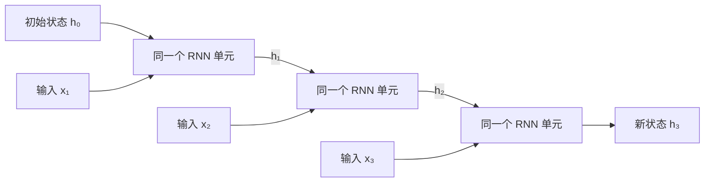

# 8 循环神经网络：从 RNN 到 LSTM、GRU

**LSTM 和 GRU 都属于循环神经网络（RNN）家族。** 它们保留“当前输入结合上一时刻状态”的基本结构，改进的是状态怎样更新、保留和遗忘。先理解这个共同点，再看各自的门控公式，就不必把它们当成三套完全无关的模型来记。

本文沿用原来的 d2l 文件位置，但按音频工程背景重新组织，作为[《Attention Is All You Need》基础解析](../论文/Attention_Is_All_You_Need_Transformer基础解析.md)和[第 0 课：LLM 基础](../omni-LLM/第_0_课：LLM基础_从音频工程到语言模型.md)的前置阅读，不严格对应《动手学深度学习》的章节安排。

> [!tip] 建议分三次阅读
> 第一次读第 1–4 节：知道状态是什么，能手算一个最简单的 RNN。
> 第二次读第 5–7 节：先理解门的用途，再看 LSTM、GRU 的公式。
> 第三次读第 8–12 节：区分双向、堆叠、流式和 RNN-T，再接回 Transformer。PyTorch 形状速查属于选读，无需运行训练。

## 1. 为什么序列模型需要“过去的信息”

### 1.1 单独一帧往往不够

设音频经过特征提取，每隔 10 ms 得到一个 80 维特征向量 $x_t$。下标 $t$ 表示第几帧；80 是特征维数，不是 80 个时间点。这里仅为说明，真实工程的帧移、维数和下采样率依配置而定。

若用一个网络独立处理每帧：

$$
y_t=F_\theta(x_t)
$$

它能利用当前特征向量包含的信息，但不能通过这个结构主动保存此前多帧的信息。想判断一个音素、音节或声学事件，前后变化通常有帮助。

处理序列有多种办法：拼接邻近帧、用时间卷积、使用循环状态，或者使用注意力。RNN 采用的是**将过去压缩成状态，再把状态传给下一步**。

### 1.2 用有状态信号处理作类比

你熟悉的一阶平滑器也会保留过去：

$$
s_t=\alpha s_{t-1}+(1-\alpha)x_t
$$

它不用保存全部历史样本，就能让当前结果受到过去影响。RNN 也有“旧状态 + 新输入 → 新状态”的结构，但把固定的线性更新换成了可学习、通常带非线性的向量运算。

这个类比只帮助理解“递推状态”。RNN 的状态维度没有预先规定的频率、能量等物理含义，也不能直接套用线性滤波器的全部性质。

> [!info] 一步是什么，取决于输入表示
> 声学 RNN 的一步可能是一帧特征，也可能是下采样后的多帧表示；文本 RNN 的一步通常是一个 token 的 embedding。它不必是一秒、一帧 PCM，或一个汉字。应先确认序列轴，再讨论“记住多少步”。

## 2. 普通 RNN：反复调用同一个状态更新函数

### 2.1 先读数据流，再读公式

最基本的 RNN 可以写成：

$$
h_t=\tanh(W_xx_t+W_hh_{t-1}+b)
$$

按计算顺序读：把当前输入变换到状态空间，把上一时刻状态也做一次变换，两者相加，再经过非线性函数，得到新状态。

| 符号 | 含义 | 本文使用的形状 |
|---|---|---|
| $x_t$ | 当前输入，如一帧声学特征 | $D$ 维向量 |
| $h_{t-1}$、$h_t$ | 旧状态与新状态 | $H$ 维向量 |
| $W_x$ | 输入到状态的权重 | $H\times D$ |
| $W_h$ | 旧状态到新状态的权重 | $H\times H$ |
| $b$ | 偏置 | $H$ 维向量 |

本文按**列向量**写公式，所以权重在左侧；有的教材按行向量写成 $x_tW_x$，相应权重需要转置。程序里还常有 batch 轴，数学含义相同。

$\tanh$ 逐元素把数映射到 $(-1,1)$，例如 $\tanh(0)=0$、$\tanh(0.5)\approx0.4621$。它既限制这里的状态数值范围，也引入非线性；不要求现在背它的指数表达式。

### 2.2 “循环”是把状态传到下一步



这叫**沿时间展开**。图中看起来有三个单元，实际上它们使用同一套 $W_x,W_h,b$。处理 100 帧并不意味着创建了 100 套参数，而是重复使用同一个更新规则 100 次。

初始状态 $h_0$ 常设为全零，也可以由别的网络提供，或作为参数学习。新输入到来后，状态随之更新。

### 2.3 参数、状态和输出不要混淆

| 对象 | 何时改变 | 保存什么 |
|---|---|---|
| 模型参数，如 $W_x,W_h$ | 通常在训练更新时改变 | 所有样本共享的处理规则 |
| 隐藏状态 $h_t$ | 每处理一个输入就重新计算 | 当前这条序列的上下文表示 |
| 任务输出 | 由状态经过输出头得到 | 类别概率、声学特征、增益等任务结果 |

例如给状态接一个分类头：

$$
\ell_t=W_yh_t+b_y,\qquad p_t=\operatorname{softmax}(\ell_t)
$$

$\ell_t$ 是候选类别的原始分数，$p_t$ 是概率分布。若任务是预测频谱增益或 Mel 特征，则输出头与损失会不同，不一定使用 softmax。

> [!note] Hidden state 不是“偷偷存起来的答案”
> 它是模型计算出的向量，会随输入变化。训练学到的是怎样用有限的状态保留对任务有帮助的信息，而不是把完整录音或句子原样藏进去。运行模型会改变状态，但通常不会顺便修改模型权重。

## 3. 手算三步，看看历史怎样留下来

为了能手算，把输入和状态都缩成一个数，指定：

$$
h_t=\tanh(0.5x_t+0.8h_{t-1}),\qquad h_0=0
$$

这些系数仅用于演示，没有经过训练。依次输入 $[1,0,0]$：

| 步数 | 当前输入 | 进入 tanh 前的数 | 更新后的状态 |
|---|---:|---:|---:|
| 1 | 1 | $0.5\times1+0.8\times0=0.5$ | 0.4621 |
| 2 | 0 | $0.5\times0+0.8\times0.4621\approx0.3697$ | 0.3537 |
| 3 | 0 | $0.5\times0+0.8\times0.3537\approx0.2830$ | 0.2757 |

虽然后两步输入是 0，状态仍不是 0，因为第一步的影响通过状态传了下来。若交换顺序，输入 $[0,0,1]$，最终状态则是 0.4621。**同样三个数，顺序不同，最终表示可以不同。**

下面的短代码只是复核这组数，不是训练程序：

```python
from math import tanh

def run_rnn(xs):
    h = 0.0
    states = []
    for x in xs:
        h = tanh(0.5 * x + 0.8 * h)
        states.append(round(h, 4))
    return states

print(run_rnn([1, 0, 0]))  # [0.4621, 0.3537, 0.2757]
print(run_rnn([0, 0, 1]))  # [0.0, 0.0, 0.4621]
```

这里还观察到旧信息逐渐衰减。但不能据此认为所有 RNN 都按固定比例遗忘：真实模型是多维的，参数、非线性和输入共同决定状态演化。示例中的零输入也不等于真实音频中的静音特征。

## 4. RNN 怎样训练，为什么长期依赖难学

### 4.1 时间展开以后，仍然是前向、损失、反向

例如用文本 RNN 预测下一个 token：先把当前 token 转成向量 $x_t$，更新 $h_t$，再预测下一个 token。给定真实目标，计算损失，再反向求参数的梯度。

难点在于：后面的预测依赖前面的状态，前面的状态又依赖更早的输入。因此后面一个位置的损失，会沿状态连接向之前的计算传递训练信号。这叫 **BPTT，Backpropagation Through Time，随时间反向传播**。

它就是对展开后的计算图使用反向传播。由于每个时间步共用参数，同一权重会收到多个时间位置贡献的梯度。更新权重通常发生在一段序列或一个 batch 完成损失与反向计算之后，不是每读一帧就必然更新一次权重。

### 4.2 梯度消失与梯度爆炸

梯度表示“参数或中间结果变化一点，会让损失变化多少”。在连续依赖中，链式法则需要将沿途的局部导数连乘。

若每一步的影响都缩小为原来的 0.5，跨 20 步就只剩：

$$
0.5^{20}\approx9.54\times10^{-7}
$$

若每一步放大 1.5 倍，20 步后约为：

$$
1.5^{20}\approx3325
$$

前者使远处的训练信号非常弱，称为**梯度消失**；后者让梯度过大，称为**梯度爆炸**。真实向量 RNN 涉及矩阵与激活导数的乘积，这两个标量算例只是说明连乘的趋势。

> [!info] “状态还有数值”与“长期关系容易学到”是两回事
> 状态非零不代表关键历史信息仍完整保留；信息对当前输出有影响，也不代表梯度足够好，让模型容易从数据中学会这种依赖。LSTM、GRU 改进的是状态更新与梯度传播路径，不能保证无限期记住所有内容。

### 4.3 两种工程手段各解决什么

**梯度裁剪**在梯度范数过大时缩小更新幅度，常用于缓解梯度爆炸。它不能把已经衰减到几乎没有的梯度恢复出来。

**截断 BPTT**把长序列分段，只沿有限长度回传梯度。例如每 100 帧反向一次：下一段可以接着使用上一段的状态数值，但在段间切断计算图。这样控制训练内存与计算量，代价是跨越截断边界的梯度路径不再被完整追踪。

> [!warning] detach 和清零不是一回事
> `detach` 保留状态数值，只阻断更早的梯度路径；清零则真的丢弃已有上下文。推理阶段通常不建反向计算图，但仍需要按连续音频流保留状态，并在独立样本或新会话边界按设计重置。

## 5. 门控：让网络自己决定信息通过多少

普通 RNN 每步都把旧状态和输入一起做变换。如果某个信息应该原样保留很多步，这种反复变换可能不利于保留它。门控网络增加了一个选择：**当前需要改多少，哪些维度可以少改一些。**

### 5.1 “门”是一组介于 0 与 1 之间的系数

常用 sigmoid 把网络算出的数变成控制系数：

$$
\sigma(a)=\frac{1}{1+e^{-a}}
$$

例如 $\sigma(0)=0.5$，$\sigma(2)\approx0.881$，$\sigma(-2)\approx0.119$。门接近 1 时大部分通过，接近 0 时大部分被抑制；通常是连续的软控制，不是代码里的 `if/else`。

对向量，门也是向量，每一维有自己的系数。符号 $\odot$ 表示逐元素相乘，例如：

$$
[0.9,0.1]\odot[2,3]=[1.8,0.3]
$$

### 5.2 门是模型算的，不是开发者手动设置的

典型门由当前输入和旧状态共同决定：

$$
g_t=\sigma(W_gx_t+U_gh_{t-1}+b_g)
$$

$W_g,U_g,b_g$ 是可训练参数，$g_t$ 是本次计算得到的门值。门通过任务损失接受训练，与声学网络里的其他层一样，不需要人工标注每帧应该“记住”还是“忘掉”。

> [!note] Sigmoid 门与 softmax 权重不同
> sigmoid 独立限制每个分量在 0 与 1 之间，不要求这些分量总和为 1。LSTM 的遗忘门和输入门也不要求互补。不要把门控理解成注意力里“对所有位置分配总和为 1 的权重”。

## 6. LSTM：单独维护一条可保留的记忆状态

LSTM 全称 **Long Short-Term Memory**。它在 1997 年提出；下面介绍的是今天常见的、带遗忘门的版本。遗忘门是后续发展加入的，不能把全部现代公式都当成 1997 年论文的原始形式。

### 6.1 两种状态分别干什么

普通 RNN 只有 $h_t$。标准 LSTM 维护两种状态：

| 状态 | 直观用途 |
|---|---|
| $c_t$：cell state，记忆单元状态 | 沿时间传递、由门控制保留和写入的内部内容 |
| $h_t$：hidden state，隐藏状态 | 从记忆内容中形成当前对外提供的表示，也用于下一步门控计算 |

两者都由输入计算得到，都属于当前序列的状态。无投影的标准 LSTM 中，两者都是 $H$ 维向量。

有些教程将 $c_t$ 叫“长期记忆”、$h_t$ 叫“短期记忆”。这可以辅助理解，但不意味着一个只能存长期信息、另一个只能存短期信息，也不是两块按照固定时长分配的缓冲区。

### 6.2 先看最关键的两行

$$
\begin{aligned}
c_t&=f_t\odot c_{t-1}+i_t\odot\widetilde{c}_t\\
h_t&=o_t\odot\tanh(c_t)
\end{aligned}
$$

第一行是 LSTM 的核心：**保留的旧内容，加上允许写入的新内容，得到新的记忆状态。** 第二行再形成当前对外提供的隐藏表示。

| 量 | 名字 | 决定什么 |
|---|---|---|
| $f_t$ | 遗忘门，forget gate | 旧记忆保留多少；接近 1 是保留，接近 0 是遗忘 |
| $i_t$ | 输入门，input gate | 新候选内容写入多少 |
| $\widetilde{c}_t$ | 候选记忆 | 根据当前输入和旧隐藏状态算出的新内容，可以为负 |
| $o_t$ | 输出门，output gate | 新记忆经过 tanh 后，对外提供多少 |

这里的“输出”指 $h_t$，不是最终生成的文字或语音。最终任务输出通常还要经过输出头。

### 6.3 三个门与候选记忆怎样算

现在再展开各自的计算：

$$
\begin{aligned}
f_t&=\sigma(W_fx_t+U_fh_{t-1}+b_f)\\
i_t&=\sigma(W_ix_t+U_ih_{t-1}+b_i)\\
o_t&=\sigma(W_ox_t+U_oh_{t-1}+b_o)\\
\widetilde{c}_t&=\tanh(W_cx_t+U_ch_{t-1}+b_c)
\end{aligned}
$$

这四行形式很像：输入都是 $x_t$ 与 $h_{t-1}$，但各有自己的权重。门使用 sigmoid 产生控制系数；候选记忆使用 tanh 产生可正可负的内容。

本文省略 peephole 等额外变体。实现中常将这些矩阵拼起来，用一次较大的矩阵运算得到多个门和候选，并不一定写成四次独立函数调用。

### 6.4 手算一个记忆维度

设某维旧记忆为 $c_{t-1}=0.8$，本步计算出的遗忘门为 0.95、输入门为 0.1、候选内容为 $-0.4$、输出门为 0.7：

$$
\begin{aligned}
c_t&=0.95\times0.8+0.1\times(-0.4)=0.72\\
h_t&=0.7\times\tanh(0.72)\approx0.4318
\end{aligned}
$$

旧信息大部分保留，只写入少量新内容。若遗忘门接近 1、输入门接近 0，则 $c_t\approx c_{t-1}$，这一步就接近“让记忆原样通过”。这些门值是教学假设；真实模型会根据输入动态计算。

> [!info] 输出门关闭，不等于记忆被删除
> 若 $o_t$ 很小，当前 $h_t$ 可以接近零，但 $c_t$ 仍可能保留内容。要判断下一步还能否利用历史，应检查完整的状态对 $(h_t,c_t)$，不能只看输出隐藏向量。

### 6.5 为什么这种结构更容易学长期依赖

普通 RNN 的历史信息每步都要经过权重变换与非线性；LSTM 给 $c_{t-1}\rightarrow c_t$ 提供了一个由遗忘门控制的直接相加路径。

**仅看这条直接路径，并暂时固定门值**，某个记忆分量跨多步的梯度会乘上沿途的遗忘门值。若这些值接近 1，梯度就更容易保留。完整网络还有经过门、隐藏状态等其他路径，因此不能把这个解释当成完整总导数。

LSTM 改善了长期依赖的学习，但仍有有限的状态容量，也仍按时间递推。门可能持续遗忘，长序列训练仍可能困难；名称中的 “Long” 不是无限记忆的保证。

## 7. GRU：用更少的门更新一个状态

GRU 全称 **Gated Recurrent Unit**，在 2014 年提出。它也使用门控保留历史，但没有单独暴露的 $c_t$，主要维护一个隐藏状态 $h_t$。

### 7.1 更新门：旧状态与候选状态如何混合

本文使用下面的约定，和 PyTorch 的状态更新方向一致：

$$
h_t=z_t\odot h_{t-1}+(1-z_t)\odot\widetilde{h}_t
$$

$z_t$ 称为更新门，$\widetilde{h}_t$ 是候选新状态。在**本文约定**里，$z_t$ 越接近 1，越保留旧状态；越接近 0，越采用新候选。

例如某维 $h_{t-1}=0.8$、$\widetilde{h}_t=-0.4$，若 $z_t=0.9$：

$$
h_t=0.9\times0.8+0.1\times(-0.4)=0.68
$$

它在旧信息上作了较小修改。和标准 LSTM 的独立输入门、遗忘门不同，这里的旧内容与候选内容系数是互补的。

### 7.2 重置门：生成候选时怎样使用历史

重置门 $r_t$ 控制旧状态对**候选新状态**的贡献。若它较小，候选可以更依赖当前输入，而减少对旧状态的依赖。

下面给出一种常见的教学写法，暂时忽略偏置：

$$
\begin{aligned}
z_t&=\sigma(W_zx_t+U_zh_{t-1})\\
r_t&=\sigma(W_rx_t+U_rh_{t-1})\\
\widetilde{h}_t&=\tanh\left(W_nx_t+U_n(r_t\odot h_{t-1})\right)
\end{aligned}
$$

先用重置门处理旧状态，再与输入一起算出候选；最后用更新门决定新状态采用多少候选。

**重置门接近 0，不等于最终状态一定清零。** 它主要作用于候选计算；若更新门仍接近 1，最终 $h_t$ 仍会大量保留 $h_{t-1}$。

> [!warning] 阅读不同资料时，先核对 GRU 的公式约定
> 有的资料把更新式写成 $(1-z_t)\odot h_{t-1}+z_t\odot\widetilde{h}_t$，此时 $z_t$ 的解释与本文相反。先看它乘在哪一项，不要只背“更新门大就是更新多”。
> 另外，PyTorch 的候选计算把重置门放在隐藏状态线性变换之后；忽略偏置时是 $r_t\odot(U_nh_{t-1})$。这与上文的 $U_n(r_t\odot h_{t-1})$ 一般不等价。阅读源码、导出或搬运权重时，必须同时核对重置位置与偏置处理；本文手算只演示最后的状态混合。

### 7.3 三种单元放在一起看

| 比较项         | 普通 RNN     | 常见 LSTM            | 常见 GRU     |
| ----------- | ---------- | ------------------ | ---------- |
| 跨步保存的状态     | $h$        | $h,c$              | $h$        |
| 主要更新方式      | 旧状态与输入一起变换 | 保留旧记忆 + 写入候选，再控制输出 | 混合旧状态与候选状态 |
| sigmoid 门   | 无          | 遗忘、输入、输出三个         | 更新、重置两个    |
| 门与候选的线性变换组数 | 1 组        | 4 组                | 3 组        |
| 长期依赖        | 通常较难训练     | 通过记忆通路和门控改善        | 通过门控保留路径改善 |

对同样输入维数 $D$、状态维数 $H$ 的单层单向模型，忽略偏置和额外投影，主要权重数大致分别为 $H(D+H)$、$4H(D+H)$、$3H(D+H)$。这解释了为什么相同维度下 GRU 通常比标准 LSTM 参数少。

但“参数少”不能直接推成“某个平台上必然更快”，也不能推成质量一定更高或更低。实际还取决于所需隐藏维数、数据、任务与算子实现。无需给 LSTM、GRU 排一个适用于所有语音系统的优劣顺序。

## 8. 双向、堆叠、投影：这些名称怎样组合

### 8.1 单元类型、方向、深度是不同维度

前面讨论的是“单个时间步怎样更新状态”。另外还可以决定网络看哪些方向，以及堆多少层：

| 设计维度 | 常见选项 | 回答的问题 |
|---|---|---|
| 单元类型 | 普通 RNN、LSTM、GRU | 每一步如何更新状态 |
| 时间方向 | 单向、双向 | 只看此前输入，还是也看后续输入 |
| 网络深度 | 单层、多层堆叠 | 同一时刻经过多少层特征变换 |
| 状态变换的变体 | 如带投影的 LSTM | 是否改变对外隐藏表示的维数等 |

因此，“两层双向 LSTM”完全成立：单元用 LSTM，正反两个方向各自递推，再把这样的结构堆两层。它不是 LSTM 之外的另一个互斥类别。

### 8.2 双向 RNN 同时利用两侧上下文

> [!info] 双向结构用来做什么
> 让每个位置的表示同时读到左右两侧的输入，适合**整段可得**的编码任务：离线 ASR 的声学编码、TTS 的文本编码、序列标注等。它不是生成结构——逐 token 生成时右侧还不存在，所以 decoder 仍需因果。
>
> Transformer 里的同一思路是 encoder-only（如 BERT）：去掉 causal mask，让所有位置互相可见。

单向网络按 $x_1,x_2,\ldots,x_T$ 处理。双向网络增加一套独立参数的反向网络，按 $x_T,x_{T-1},\ldots,x_1$ 处理，最后合并同一位置的两个表示：

$$
h_t=\operatorname{Concat}(\overrightarrow{h}_t,\overleftarrow{h}_t)
$$

如果两个方向各是 $H$ 维，拼接后就是 $2H$ 维。BiLSTM、BLSTM 通常都指双向 LSTM；BiGRU 则是双向 GRU。

这里的“反向”是前向推理时，另一个网络反着读取输入，**不是反向传播**。反向传播是训练中计算梯度，两者是不同概念。

完整双向网络需要后面的输入，所以在整句录音已经到齐的离线识别、完整文本已经可用的 TTS 文本编码中很自然。如果要逐帧实时处理持续到来的音频，则必须考虑等待未来输入的代价。

> [!warning] 双向网络能不能流式，要看它读取多大范围
> 整句双向依赖不能直接用于无未来等待的逐帧输出。可以设计分块双向、有限右看等方案，但这会限定可访问范围并引入相应等待，需要匹配训练与推理方式。单向也不自动保证整条 pipeline 因果：特征窗口、卷积、归一化等环节仍可能使用未来信息。

### 8.3 堆叠网络有时间轴，也有层数轴

第二层在时刻 $t$ 读取第一层同一时刻的输出，并读取第二层自己在上一时刻的状态：

$$
h_t^{(2)}=F^{(2)}(h_t^{(1)},h_{t-1}^{(2)})
$$

上标表示层号，下标表示时间步。同一层沿时间共享参数，不同层通常使用不同参数；每层都维护自己的状态。

语音资料中还常见 **LSTMP**：给 LSTM 的隐藏输出增加投影，使 cell state 可以较宽、对外隐藏表示较窄，用来调整容量与计算量。peephole LSTM 则让门控额外读取 cell state。现阶段知道它们改了哪一处即可，不必一次记完所有变体。

## 9. 接回音频 pipeline：状态怎样跨块传递

### 9.1 音频块边界不等于上下文结束

假设一条连续音频分成 A、B 两块。对于单向 LSTM，A 块得到的最终状态对 $(h,c)$，应作为 B 块的初始状态，才能延续上下文：

```text
块 A + 初始 (h₀, c₀) → 块 A 的输出 + (h_A, c_A)
块 B +       (h_A, c_A) → 块 B 的输出 + (h_B, c_B)
```

在相同输入序列、相同初始状态、确定性的推理设置下，纯单向循环层连续处理整段与分块传递完整状态，应得到相同或仅有数值误差的结果。实际完整模型还可能有卷积缓存、特征提取状态等，这些同样需要延续。

> [!info] 这和 Transformer 的“上下文续接”不是同一机制
> RNN 把历史压进固定大小的 $(h,c)$ 传下去，是有损压缩；Transformer 保留全部历史 token 重新注意，KV cache 只是免去重算，容量随序列增长。流式 ASR/TTS 跨块传递的可能是 RNN 状态，也可能是卷积/注意力缓存；LLM 的“缓存命中”要求前缀 token 完全相同。TTS 零样本克隆的“上下文”是参考音频条件，不是状态续接。

### 9.2 两种相反的错误

**每块都清零**：模型反复失去前面音频的上下文，块边界处可能出现识别或增强效果变化。

**不同音频流共用状态**：A 会话的状态被送入 B 会话，产生错误的上下文混用。batch 里的不同样本也应各有自己的状态，批次内顺序变化时必须保持对应关系。

是否在 VAD 端点重置，要结合模型训练方式和任务边界决定。VAD 判断结束、音频流结束、对话历史结束不是同一个事件。

> [!note] Padding 不会天然让 RNN “停下来”
> 即使补齐输入是全零，旧状态、偏置和非线性仍可能继续更新状态。训练变长序列时，需要正确处理有效长度，例如使用 packed sequence、状态更新 mask 或等价方案。只忽略 padding 位置的输出损失，不一定就得到了每条序列真正结束时的状态。

### 9.3 固定状态的优势与边界

固定层数和维数的单向 RNN，在推理时仅需保留固定大小的循环状态，状态量不必随累计帧数增长。这是它适合连续信号处理、受限设备的一项原因。

不过，**训练内存不是固定的**：为了反向传播，通常还要保存各时间步的中间计算，内存随展开长度增长。也不能从“推理状态固定”推导出“能无损保存无限历史”。

> [!info]- 选读：PyTorch 中 output、h_n、c_n 的形状
> 以下限于普通、无投影的 LSTM / GRU，并设 `batch_first=True`。令 B 为 batch 大小、T 为序列长度、D 为输入维数、H 为隐藏维数、L 为层数、K 为方向数（单向为 1，双向为 2）。
>
> - 输入形状为 `[B, T, D]`。
> - `output` 为 `[B, T, K*H]`，包含最后一层各时间位置的隐藏输出。
> - `h_n` 为 `[L*K, B, H]`，包含各层、各方向的最终隐藏状态。
> - LSTM 还有同样为 `[L*K, B, H]` 的 `c_n`；GRU 没有单独的 `c_n`。
> - `batch_first` 不改变 `h_n`、`c_n` 的轴顺序。多层 LSTM 续接下一块时，要传递完整的 `(h_n, c_n)`。
>
> 双向情况下，`output[:, -1, :]` 不等于两个方向都完成整段处理后的最终状态；它的反向部分对应原序列末端的位置。读接口时应区分“各位置输出”和“各方向最终状态”。

## 10. 在 ASR、TTS 中看到的 RNN 可能负责什么

### 10.1 同一类网络，可以接不同任务与输出头

| 场景 | RNN / LSTM / GRU 可能承担的角色 | 还需要什么 |
|---|---|---|
| VAD、关键词检测 | 汇集过去若干帧的声学线索 | 对应标签、输出头及检测策略 |
| 语音增强、回声消除 | 跟踪随时间变化的声学状态 | 特征设计、掩码或波形估计、损失与重建流程 |
| ASR 编码器 | 把声学特征变成含上下文的表示 | CTC、Transducer 或其他对齐与解码方案 |
| 文本语言模型 | 根据已知 token 更新上下文，预测下一 token | tokenizer、词表输出层与语言建模训练 |
| TTS | 编码文本，或在一些自回归声学模型中逐步产生特征 | 文本—音频对齐、声学目标、声码器等 |

这些是常见用途，不表示所有现代系统都这样实现。例如 Tacotron 2 使用了循环网络，而许多现代 TTS 使用 Transformer、卷积、flow/diffusion 等不同组合。

### 10.2 RNN 层本身不负责解决全部对齐问题

基本的循环层处理 $T$ 个输入位置，会计算 $T$ 个状态。可以只取最后一个状态做整段分类，也可以使用所有位置的状态。

但 ASR 常有几百帧输入、几十个 token 输出；LSTM 本身并没有规定怎样把这两个长度对应起来。CTC、Transducer、带注意力的 Encoder–Decoder 等方案，处理的是额外的对齐或生成问题。类似地，TTS 也不能仅靠“把文本放进 LSTM”就自动得到合适长度的语音。

### 10.3 RNN-T 的名字容易造成误解

**RNN 是一类网络结构；RNN-T 是 Transducer 建模方案的历史名称。** 原始 RNN-T 使用循环网络，但现代 Transducer 的 encoder 可以使用 LSTM，也可以用 Conformer、Zipformer 等结构；prediction network 也可以使用固定长度 token 历史，而不维护循环隐藏状态。

所以看到 `encoder.onnx`、`decoder.onnx`、`joiner.onnx`，可以去核对 Transducer 三部分的功能，却不能仅凭文件名判断内部用了 GRU 还是 LSTM。看到 “Zipformer Transducer”，也不应把 Zipformer 自动归类成普通 RNN。

后续可结合[CTC 笔记](../智能语音/第_5_课：CTC无对齐的端到端训练.md)与[RNN-T 笔记](../智能语音/第_6_课：RNN-T-Transducer.md)学习对齐；本篇先把“内部状态更新结构”与“任务建模方案”分清。

## 11. 为什么学完 RNN，再读 Transformer 会更容易

### 11.1 LSTM、GRU 改善记忆，仍保留递推依赖

对于标准 RNN、LSTM、GRU，都需要先得到 $h_{t-1}$，才能完成 $h_t$ 的计算。即使整段输入已知，同层的时间状态链仍依次推进。

不同样本的 batch、矩阵运算以及部分输入投影可以并行，所以“RNN 完全不能用 GPU 并行”是不准确的。真正限制的是**标准循环单元内部沿时间的状态依赖**。

Transformer 则让同一层的多个位置读取上一层已经就绪的表示，通过注意力汇集信息。因此已知输入的多个位置能在同一层中并行计算，并且允许远处位置直接交互。

| 比较点 | 标准单向 RNN / LSTM / GRU | 全局注意力 Transformer |
|---|---|---|
| 利用历史的主要方式 | 将历史信息持续更新到状态中 | 从可访问位置的表示中加权汇集信息 |
| 同层位置之间 | 有前一状态到后一状态的递推依赖 | 读取上一层表示，可并行计算多个位置 |
| 较远的信息怎样到达 | 经过中间多个时间步传递 | 在允许的注意力连接中可以直接到达 |
| 常见增量推理的历史存储 | 固定大小的循环状态 | 标准 KV cache 随上下文长度增长 |

这里比较的是标准形式；滑动窗口、缓存压缩和其他架构会改变存储方式。也不能仅凭这张表判断某个小模型在你的设备上谁更快。

### 11.2 从 Seq2Seq 到注意力，再到 Transformer

早期的一种 Seq2Seq 做法，用编码器的最终状态概括输入，再交给解码器生成输出。整个输入挤进固定向量，可能形成信息瓶颈。

随后，注意力让解码器可以访问编码器各位置的状态，按需读取相关部分，而不只依赖最终状态。这时编码器、解码器仍然可以是 LSTM 或 GRU。

Transformer 再进一步，用注意力承担序列内部的信息交互，去掉原架构中的循环层。**注意力和 RNN 可以组合；它们并非一开始就是互斥的两种系统。**

> [!info] “循环”与“自回归”不是同一个概念
> 循环描述网络内部用前一状态计算后一状态；自回归描述生成时用已有输出继续预测后续输出。RNN 可以做不生成 token 的音频增强；Transformer 也可以自回归生成文本。
> 因此 Transformer 训练时可以并行计算已知目标位置，并不意味着推理时未知的后续 token 也能一次全部生成。

现在回读 Transformer 论文中的动机，就能区分两个问题：LSTM、GRU 主要改善怎样保留与学习历史信息；Transformer 改变了序列位置之间的信息交互方式和并行计算条件。

## 12. 自测与后续阅读

先尝试用自己的话回答，不必逐字复述公式：

1. 同一个 RNN 处理 100 帧，会创建 100 套权重吗？每帧发生变化的主要是什么？
2. 普通 RNN、LSTM、GRU 分别需要跨步保存哪些状态？
3. LSTM 遗忘门接近 1、输入门接近 0 时，记忆状态大致怎样变化？输出门很小又意味着什么？
4. 按本文约定，GRU 更新门接近 1 时更保留旧状态，还是更采用候选？重置门接近 0 是否必然清零最终状态？
5. 双向网络的“反向”与 BPTT 的“反向”有什么不同？
6. 连续音频分两块推理，为什么不应随意在块边界清零？训练中 `detach` 又是否会清零？
7. RNN-T 模型是否一定使用 LSTM 编码器？
8. Transformer 没有普通循环层，为什么仍可以逐 token 自回归生成？

> [!success]- 参考答案
>
> 1. 不会；同一层沿时间共享参数。每帧主要更新当前序列的状态和输出。
> 2. 普通 RNN 和 GRU 保存 $h$；标准 LSTM 保存 $(h,c)$。多层网络需要各层对应的状态。
> 3. $c_t$ 接近旧的 $c_{t-1}$。输出门很小会抑制 $h_t$，但不等于删除 $c_t$。
> 4. 更保留旧状态。重置门控制候选如何利用历史，最终混合还受更新门控制，所以不必清零。
> 5. 双向网络的反向分支反着读取输入；BPTT 是训练时沿依赖关系向前面的计算传递梯度。
> 6. 块边界通常不是上下文结束，清零会丢失历史。`detach` 保留数值，只切断更早的梯度路径。
> 7. 不一定。Transducer 可以使用不同编码器及 prediction network 结构。
> 8. 自回归是输出对已有前缀的依赖，可以由循环网络或因果 Transformer 等不同结构实现。

建议按这个顺序继续：本篇 → [Transformer 基础解析](../论文/Attention_Is_All_You_Need_Transformer基础解析.md) → [第 0 课：LLM 基础](../omni-LLM/第_0_课：LLM基础_从音频工程到语言模型.md)。先能说清状态、门控、时间依赖，再回到注意力公式。

## 参考资料

- 《动手学深度学习》：[循环神经网络](https://zh.d2l.ai/chapter_recurrent-neural-networks/rnn.html)、[门控循环单元](https://zh.d2l.ai/chapter_recurrent-modern/gru.html)、[长短期记忆网络](https://zh.d2l.ai/chapter_recurrent-modern/lstm.html)。适合后续补充推导与练习。
- Hochreiter & Schmidhuber, **Long Short-Term Memory**, 1997：[论文 DOI](https://doi.org/10.1162/neco.1997.9.8.1735)。LSTM 的原始工作。
- Gers, Schmidhuber & Cummins, **Learning to Forget: Continual Prediction with LSTM**, 2000：[论文 DOI](https://doi.org/10.1162/089976600300015015)。遗忘门的后续发展。
- Cho et al., **Learning Phrase Representations using RNN Encoder–Decoder for Statistical Machine Translation**, 2014：[arXiv:1406.1078](https://arxiv.org/abs/1406.1078)。GRU 的早期工作。
- PyTorch 官方接口：[LSTM](https://docs.pytorch.org/docs/stable/generated/torch.nn.LSTM.html)、[GRU](https://docs.pytorch.org/docs/stable/generated/torch.nn.GRU.html)。用于核对状态形状、门的约定，以及 GRU 重置门实现差异。
- Graves, **Sequence Transduction with Recurrent Neural Networks**, 2012：[arXiv:1211.3711](https://arxiv.org/abs/1211.3711)。用于区分循环单元与原始 RNN-T 建模方案。
