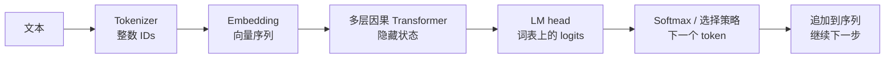

# 第 0 课：LLM 基础——从音频工程到语言模型

> 本卷入口：[总纲与路线图](./端到端语音大模型学习笔记.md)。下一课：[MiniMind-O 架构解剖与基线测量](./第_1_课：MiniMind-O架构解剖与基线测量.md)。
> 适用背景：已经做过 ASR/TTS、模型微调与推理部署，希望读懂 LLM 的训练和生成过程。
> 本课以理解为目标，不要求启动训练、接入 ROS 或替换语音模型。只需要认识向量、矩阵、概率和梯度下降；遇到公式，先读紧接着的解释。

> [!tip] Transformer 前置阅读
> 如果对向量、Q/K/V、自注意力或 Transformer 结构还不熟悉，先读 [《Attention Is All You Need》基础解析](../论文/Attention_Is_All_You_Need_Transformer基础解析.md)。它从向量与加权求和开始，包含一次完整的注意力手算，再解释训练并行、因果遮罩与原论文结构。

## 0. 学完后，你应该能解释什么

你已经跑过 MiniMind-O，观察是“响应挺快，但智能和语音质量有限”。这一课先建立判断这些现象的基础：到底是模型没有学会任务，还是输入表示、生成策略或运行方式造成了问题。

读完后，应能用自己的话回答：

1. 文本怎样变成模型可以计算的输入？token、embedding 和 hidden state 分别是什么？
2. “预测下一个 token”为什么能用于问答？为什么它仍会答错？
3. 训练时答案已经给出，模型究竟还在学什么？怎样防止它偷看答案？
4. 一次前向计算与完整生成有什么区别？KV cache 缓存了什么？
5. 预训练、SFT、LoRA、蒸馏和量化分别改变什么？
6. MiniMind-O 怎样在语言模型上增加语音能力？哪些能力不能靠一个接口自动获得？

建议分三次读：第一次读第 1–4 节，跟完一个预测与训练样本；第二次读第 5–7 节，理解网络与推理；第三次读第 8–11 节，把概念接回音频工程并做自测。先能讲清数据流，再记缩写。

本文的代码事实核对于本地 MiniMind-O `a989ea1`，源码路径相对于 `/home/u/source/open_source/minimind-o`。示例中的玩具 token 会明确标注；本地 tokenizer 实测结果另行列出，二者不要混用。下载的 `minimind-3o/` 也带有模型 Python 文件，通过 `trust_remote_code=True` 加载时可能运行那份代码，需要与仓库 `model/` 下的实现区分。

## 1. 从你熟悉的 ASR 开始：都是条件序列预测

### 1.1 模型回答的是一个概率问题

ASR 要估计“给定这段声音，最可能说了哪些字”；语言模型要估计“给定前面的内容，接下来可能出现哪些 token”。

| 任务 | 已知条件 | 要生成的对象 |
|---|---|---|
| ASR | 音频及可选的语言、热词等条件 | 转写文本 |
| 文本语言模型 | 前面的文本 token | 后续文本 token |
| TTS | 待朗读文本、音色等条件 | 声学特征、音频码或波形，取决于模型 |
| 语音对话 | 用户语音、任务说明和历史 | 助手回复文本与语音 |

这些任务可以都写成条件概率，但训练目标不同。ASR 应忠实转写“请把音量调到百分之三十”；对话模型可能回答“好的”。把 ASR 的监督换成助手回答，就是在教另一个任务。

对于自回归文本语言模型，把一段 token 序列记为 `x₁, x₂, …, xₙ`，模型用参数 `θ` 估计：

$$
p_\theta(x_1,\ldots,x_n)=\prod_{t=1}^{n}p_\theta(x_t\mid x_{<t})
$$

这里 `x_<t` 表示当前位置之前的 token；实际实现常用序列起始标记或已有 prompt 作为条件。公式的含义是：**整段文字的概率，可以拆成每一步“在已有前文下，下一个 token 的概率”的乘积。**

“自回归”表示生成的结果会进入下一步的输入。它不要求使用 RNN；Transformer 同样可以自回归生成。

### 1.2 为什么预测后续文字能变成问答

如果训练数据里反复出现“问题、回答”的结构，那么给模型一个问题和回答起始标记，继续预测的内容就可能是答案。学习高质量续写，也会促使模型从数据中形成语言规律、事实关联和一定的问题求解能力。

但损失函数直接奖励的是“给训练目标更高的概率”，并没有直接接入一个万能的事实验证器。模型可以生成语法正确、听起来合理但事实错误的回答。训练覆盖、数据质量、模型容量和具体任务都会影响可靠性。

对机器人而言，还要区分“说得像做到了”和“真的做到了”。只有工具或设备状态反馈，才能确认音量已改变、动作已完成。LLM 生成“已完成”这几个字本身不是执行凭证。

### 1.3 与 CTC / RNN-T 的联系与区别

你熟悉的 RNN-T 也会利用输出历史；但它还要处理声学时间轴、blank 和音频到文本的对齐。纯文本 LLM 的训练文本已经给出了 token 顺序，最基本的 next-token 训练无需像 CTC/RNN-T 那样对潜在对齐路径求和。

因此，ASR 的 blank、LLM 的 padding、回答结束的 EOS 是三个不同概念。不能把“这个位置没有文字”都理解成同一种空白标签。

## 2. 文本进入网络之前：token 与 embedding

### 2.1 Tokenizer 做离散编码

Tokenizer 把字符串拆成 token，再把每个 token 映射为词表中的整数 ID。token 可能对应一个字、多个字、子词、标点、字节片段或特殊标记。

```text
字符串 → tokenizer → token ID 序列
"机器人"             [3697]      ← 当前本地词表的实测例子
```

ID 是索引，不是连续的语义数值。编号 3697 不表示“比编号 1000 更像机器人”，相邻编号也不意味着语义接近。

当前 tokenizer 使用 6400 词表的 byte-level BPE：先使用字节级表示，再根据学习到的合并规则组成更长的 token。**中文一个字通常占三个 UTF-8 字节，不等于一个字一定占三个 token。**

2026-11-10 使用仓库 `model/` tokenizer、`add_special_tokens=False` 的实测结果：

| 原始文本 | token IDs | token 数 |
|---|---|---:|
| `你好` | `[1968]` | 1 |
| `机器人` | `[3697]` | 1 |
| `请把音量调到30%。` | `[960, 5038, 1271, 584, 880, 512, 2921, 40, 302]` | 9 |
| `Turn left.` | `[87, 1262, 4299, 49]` | 4 |
| `2026-11-10` | `[1354, 53, 57, 48, 2485, 48, 1218]` | 7 |

这是完整短字符串在当前 tokenizer 下的切分；放到不同前后文中，尤其涉及空格和边界时，不应假定切分永远相同。换 tokenizer 后，ID 也不能直接沿用。

### 2.2 Embedding 是可训练的查表

> [!info] Embedding 是什么
> 一个 `[V, D]` 的可训练矩阵：用 token ID 作行号取出一行，把离散符号换成连续向量。前向等价于 one-hot 乘矩阵，反向只向被取到的行累加梯度；行内数值由 next-token 训练决定，初始化随机。同一个 token 在任何位置都取同一行，上下文要等后续 Transformer 层才注入。
>
> 当前 MiniMind 默认令 embedding 与 `lm_head` 共用同一张矩阵，所以 `logit_i = h · e_i`：这一行既是该 token 的输入向量，也是它在输出端的打分方向。

设词表大小为 `V`（即 2.1 中 tokenizer 的词表条目数），隐藏维度为 `D`，embedding 矩阵形状就是 `[V, D]`。输入 ID 为 3697，就取出矩阵第 3697 行，得到一个长度为 `D` 的向量。

对于当前 MiniMind，`V = 6400`，`D = 768`：

```text
input_ids: [B, T]       整数，B 条序列，每条 T 个位置
embedding: [6400, 768]  浮点参数
查表结果:  [B, T, 768]  每个位置对应一个向量
```

与音频前端对照：Mel 特征来自对声音的信号变换；文本 embedding 来自 ID 查表，并随训练更新。二者最终都可以作为神经网络的向量输入，但来源和信息含义不同。

### 2.3 Hidden state 是融合上下文后的表示

同一个 token，在 embedding 层通常取同一行向量；进入 Transformer 后，它会与允许访问的上下文发生交互，逐层得到 hidden state。

例如“打开门”和“门已经打开了”中的相关词，需要在各自上下文中形成不同的表示，才能区分命令与状态描述。hidden state 是训练得到的连续表征，并不是一个人类可直接读取的意图枚举。

这也是为什么更换编码器或 LLM 时，“两边都是 768 维”仍然不够。相同 shape 只说明矩阵能相乘，不说明两边学会了同一种表示。

## 3. 一次前向计算：从输入到下一个 token 的分布

先看普通的 decoder-only 文本模型，不加入语音支路：



`LM head` 是把隐藏维度映射到词表维度的输出层。某个位置的输出是 `V` 个分数，称为 logits；它们可以为负，也不要求和为 1。经过 softmax 后，才得到概率分布。

$$
p_i=\frac{\exp(z_i)}{\sum_{j=1}^{V}\exp(z_j)}
$$

这里 `z_i` 是第 `i` 个词表项的 logit。某个 token 的分数相对其他 token 越高，其概率越大。

下面的概率是教学假设，不是 MiniMind 的实测输出：

| 已有前文 | 下一个 token 候选 | 假设概率 |
|---|---|---:|
| `请把音量` | `调` | 0.60 |
| 同上 | `关` | 0.25 |
| 同上 | 其他所有 token | 0.15 |

模型提供分布，生成策略决定怎样选。贪心选择会取概率最大的 token；采样则可能选到其他候选。选出 token 后，解码器将它追加到输入，继续下一步。

完整回答通常要执行多次前向计算。**`forward()` 产出张量，`generate()` 管理循环、缓存、采样和停止条件。** 后者的行为不是神经网络权重的一部分。

MiniMind 中对应 `MiniMindForCausalLM.forward()` 和 `generate()`。MiniMind-O 又覆写了自己的生成循环，因此两个类支持的参数和停止行为不能直接等同。

## 4. 训练：答案已知，仍然需要学习预测

### 4.1 用一条序列构造许多个预测问题

为便于观察，下面使用**人工指定的玩具 token**，不是实际 tokenizer 的切分：

```text
完整序列： [BOS, 请, 开灯, EOS]
输入 X：  [BOS, 请, 开灯]
目标 Y：  [请, 开灯, EOS]
```

| 输入位置 | 模型在这个位置可以看到什么 | 这个位置要预测什么 |
|---|---|---|
| 0 | `BOS` | `请` |
| 1 | `BOS 请` | `开灯` |
| 2 | `BOS 请 开灯` | `EOS` |

每个位置都给出一个词表分布，目标是让正确下一个 token 的概率变高。这就是常说的标签错位一位或 next-token shift。

容易踩的代码细节：有的模型要求 `labels = input_ids`，在 `forward()` 内部做错位；有的 Dataset 已经构造 `X = tokens[:-1]`、`Y = tokens[1:]`。**不能两边都错位，否则变成预测后面第二个 token。** 当前仓库的纯文本 `MiniMindForCausalLM.forward()` 内部错位，而 Omni Dataset 已经对输入与标签进行了错位，Omni 训练脚本直接计算对应位置的损失。

### 4.2 Teacher forcing 与 causal mask

训练时直接使用真实前文，例如用正确的“请”去预测“开灯”，称为 teacher forcing。推理时没有标准答案，下一步只能接着模型自己选出的 token 往下生成。

训练可以一次输入整条序列，但必须用 causal mask 屏蔽未来位置：

```text
                 可访问的 key 位置
                  0   1   2
query 位置 0      ✓   ×   ×
query 位置 1      ✓   ✓   ×
query 位置 2      ✓   ✓   ✓
```

> [!info] Causal mask 是怎么起作用的
> 在 softmax 之前给分数矩阵加掩码：$M_{ij}=0$（$j\le i$），$M_{ij}=-\infty$（$j>i$）。$e^{-\infty}=0$，未来位置的权重自然变成 0，等于从未参与。
>
> MiniMind 用 `torch.triu(1)` 造出上三角的 $-\infty$；走融合 kernel 时改传 `is_causal=True`，不显式保存整张掩码。它是结构性约束，不是可训练参数。

因此，训练能并行计算各位置，而不会让位置 0 直接读取后面的答案。这是“位置并行计算”与“因果约束”同时成立的原因。普通自回归推理仍要逐步决定未知 token；推测解码等加速方法留到后续课程。

### 4.3 Cross entropy：正确答案分到的概率越小，罚得越重

若某个位置的正确 token 为 `y`，该位置的交叉熵是：

$$
L_t=-\log p_\theta(y\mid\text{prefix})
$$

| 分给正确 token 的概率 | 使用自然对数的损失 |
|---:|---:|
| 0.8 | 约 0.223 |
| 0.2 | 约 1.609 |
| 0.01 | 约 4.605 |

训练通过反向传播计算梯度，再由优化器更新参数，让目标序列更容易被预测出来。真实实现通常直接把 logits 交给 `CrossEntropyLoss`，由它完成数值稳定的 log-softmax，避免先手工 softmax 再重复处理。

若使用有效 token 上的平均负对数似然 `L`，困惑度 `PPL = exp(L)`。它衡量预测分布对数据的适配程度；比较时需要相同的 tokenizer、数据和统计口径，不能把不同任务的总 loss 直接拿来排名。

### 4.4 三种 mask 分别管什么

| 名称 | 管什么 | 典型例子 |
|---|---|---|
| Causal mask | 当前 query 能访问哪些前后位置 | 屏蔽未来 token，防止偷看 |
| Padding attention mask | 哪些填充位置不应作为有效上下文 | 不让补齐长度的 PAD 干扰注意力 |
| Loss mask | 哪些位置计入优化目标 | SFT 中只监督 assistant 回答 |

这是三个逻辑职责，具体实现可能组合它们，或者在某些布局下省略一个显式 mask。`labels = -100` 是 PyTorch 中常用的忽略损失约定，**不是一个应该送进 embedding 的词表 ID**。

只对 assistant 计算 loss，不等于模型不读 user，也不等于 user 对应的表示不会收到梯度。回答通过注意力依赖输入上下文，损失仍可沿这条路径反向传播。

### 4.5 为什么 loss 下降不等于模型更有用

模型可能记住少量训练样本，也可能学会了高频套话，却没有改善你关心的否定指令、数字或多轮指代。需要同时观察未参与训练的验证数据和任务指标，并检查训练集与评估集是否重复。

你在 TTS 中已经熟悉“训练 loss 很低，试听仍然不好”的情况。LLM 同样需要把损失曲线与真实能力分开。小样本过拟合是检查训练链路是否通畅的办法，不是泛化能力的证据。

**停下来检查：** 为什么训练时可以一次算三个位置，推理时却通常不能一次决定三个未知 token？如果你能同时说清 teacher forcing 和 causal mask，就可以继续往下读。

## 5. Transformer block：先理解信息怎么流动

> [!info] Transformer 是什么，为什么成了 LLM 的基础架构
> 一个把「因果自注意力 + 逐位置 FFN」重复堆叠、每层带残差与归一化的网络。它压过 RNN/CNN 的关键在三点：任意两个位置一层可达，长依赖不必沿时间步传递；训练时整条序列并行，计算主体是 GPU 擅长的大矩阵乘；结构先验弱，关系从数据里学，因而能随参数、数据、算力同步放大。
>
> 代价是注意力对长度呈平方开销、生成仍要逐 token；KV cache、GQA、FlashAttention 都是围绕这两个代价的工程手段。

### 5.1 Decoder-only 中的 decoder 是什么

原始 Transformer 有 encoder 和 decoder；现代文本 LLM 常用 decoder-only 结构，即用因果 self-attention 堆叠出语言模型。它并不是必须先有一个音频 encoder 才能工作的“解码器”，也通常不带原始 encoder-decoder 结构中的 cross-attention。

MiniMind 的 block 可以概括为：

```text
h → RMSNorm → Causal Self-Attention → 与原 h 相加 → h'
h' → RMSNorm → FeedForward / SwiGLU → 与原 h' 相加 → h''
```

每经过一个 block，输出仍然保持 `[B, T, D]` 的主要形状，但其中的表示发生变化。多层堆叠后，再通过最终归一化和 LM head 输出词表分数。

### 5.2 Attention 用当前内容检索上下文

从输入隐藏状态分别经过可训练线性映射，得到 Query、Key、Value，也就是 Q、K、V：

- Q：当前位置用什么特征去寻找相关上下文。
- K：其他可见位置提供什么特征供匹配。
- V：匹配后实际汇集的信息。

> [!info] Q、K、V 与词表 `V` 不是同一回事
> Q/K/V 是每个位置算出来的激活：Q 为 `[B, T, 8, 96]`，K/V 为 `[B, T, 4, 96]`，由 `h` 乘 `q_proj`、`k_proj`、`v_proj` 得到。参数是这三个线性层，不是 `[V, D]` 表；这里 V 指 Value，`[V, D]` 里的 V 是词表大小。
>
> 两者只在隐藏维度 `D` 上相遇：词表空间只出现在输入查表和 LM head 输出，attention 全程在 768 维隐藏空间里工作。

对一个注意力头，计算可以概括为：

$$
\operatorname{Attention}(Q,K,V)=\operatorname{softmax}\left(\frac{QK^\top}{\sqrt{d_k}}+M\right)V
$$

`QKᵀ` 比较各位置的匹配程度，`√d_k` 用来调节数值尺度；`M` 是 mask，在允许访问的位置加 0，在禁止的位置加负无穷，softmax 后禁止位置的权重就是 0。最后按权重汇集 V。

“检索”是帮助理解计算的类比，不代表每个头都有人工指定的语法职责，也不能把一张 attention 热力图直接当成完整推理解释。

### 5.3 其余缩写，各记一个作用

| 模块 | 先掌握的作用 | MiniMind 中的入口 |
|---|---|---|
| Multi-head attention | 用多组投影从不同表示子空间汇集信息 | `Attention` |
| GQA | 多个 Q 头共享较少的 K/V 头，降低 K/V 存储与带宽需求 | `num_attention_heads`、`num_key_value_heads` |
| RoPE | 对 Q/K 施加随位置变化的旋转，让注意力利用位置信息 | `apply_rotary_pos_emb` |
| RMSNorm | 调节向量尺度，帮助稳定计算与训练 | `RMSNorm` |
| SwiGLU / FFN | 在每个位置上做带门控的非线性特征变换 | `FeedForward` |
| Residual connection | 把子层输出与原表示相加，支持深层信息与梯度传递 | `MiniMindBlock.forward` |

FFN 按位置计算，并通过前面的 attention 使用已经混合了上下文的表示。不能把整个 block 理解成只有 attention 在工作。

MiniMind 还对 Q/K 做了归一化；上面的公式是通用计算骨架，具体顺序以 `Attention.forward()` 为准。本课先看 dense 版本，MoE 的专家路由和辅助损失留到后面。

### 5.4 跟踪一次张量形状

设 `B = 2`，`T = 16`，采用当前 MiniMind 的 `D = 768`、`V = 6400`、8 个 Q 头、4 个 K/V 头，每头 96 维：

| 张量 | 形状 | 含义 |
|---|---|---|
| `input_ids` | `[2, 16]` | 两条 token 序列 |
| embedding / block hidden state | `[2, 16, 768]` | 各位置的连续表示 |
| Q，拆头后尚未转置 | `[2, 16, 8, 96]` | 8 个 query 头 |
| K/V，拆头后尚未转置 | `[2, 16, 4, 96]` | 4 个共享 key/value 头 |
| 逻辑上的 attention scores | `[2, 8, 16, 16]` | 每个 Q 头对可见位置的匹配分数 |
| LM head 输出 logits | `[2, 16, 6400]` | 每个位置的下一个 token 分数 |

融合的 attention kernel 不一定显式保存完整 scores 矩阵；这里列的是理解运算用的逻辑形状。做生成时，选择下一个 token 通常只用最后位置的 logits；做训练时，可以对所有有效位置计算损失。

## 6. 从语言模型到助手：能力来自哪些训练

### 6.1 预训练、继续预训练与 SFT

| 阶段 | 数据通常长什么样 | 优化目标与用途 |
|---|---|---|
| 文本预训练 | 文章、代码等 token 序列 | 用大量 next-token 监督学习语言与数据中的规律 |
| 继续预训练 | 更有针对性的领域语料或新模态数据 | 在已有权重上继续学习，具体目标取决于训练方案 |
| SFT，监督微调 | 指令 / 对话上下文与目标回答 | 教模型按任务和角色要求生成回答，常只计算回答部分的 loss |
| 偏好或奖励训练 | 偏好的回答对，或能打分的生成结果 | 改善回答选择、行为和特定任务表现；方法如 DPO、RL，暂不展开 |

这些阶段不保证全部出现，也不存在“做过 SFT 就一定聪明”的规则。SFT 可以教会新格式和任务，也能改变已有能力；结果取决于数据、训练强度和基座能力。

MiniMind-O 推荐的 mini 流程加载已有的 `llm_768.pth`，再接入语音任务；SenseVoice、Mimi 等也有各自的预训练。上游所说“约两小时跑通 mini”，指特定配置下的 Omni SFT 链路，不是两小时从随机参数训练出语言、听觉和发声的全部能力。

### 6.2 Chat template 把角色变成序列结构

应用程序中的消息是结构化数据：

```json
[
  {"role": "user", "content": "请把音量调到30%。"},
  {"role": "assistant", "content": "好的，调到30%。"}
]
```

模型最终接收的却是 token 序列。Chat template 把角色、边界和内容串起来，概念上类似：

```text
<user-start> 请把音量调到30%。 <turn-end>
<assistant-start> 好的，调到30%。 <turn-end>
```

以上标记仅为教学示意。当前 MiniMind 实际使用 `<|im_start|>`、角色文本和 `<|im_end|>` 等；模板还可能插入 `<think>` 相关内容，应以 `apply_chat_template()` 的真实结果为准。

模型通过训练学会这些角色和边界的用法。更换 chat template 后，虽然权重没变，输入分布却可能改变，结果也可能退化。自行添加一个叫 `<task_asr>` 的字符串，并不能凭空赋予模型 ASR 能力；它需要对应的任务训练。

### 6.3 全量微调、冻结与 LoRA

这三者回答的是“更新哪些参数”，与“用什么数据教什么任务”是两个维度。

| 方法 | 更新什么 | 主要取舍 |
|---|---|---|
| 全量微调 | 选定模型中的全部可训练参数 | 自由度大，优化器与梯度开销大，也可能改写已有能力 |
| 冻结主干、只训 projector/head | 新增或指定的小模块 | 成本较低，但固定表征未必足够完成任务 |
| LoRA | 在指定线性层上学习低秩增量 | 减少可训练参数与对应优化器状态，能力仍受基座、插入位置和数据影响 |

LoRA 的基本写法是 $W_eff = W₀ + s × BA$。原权重 `W₀` 固定，训练较小的矩阵 B、A，`s` 为缩放系数。它并不是把基座权重文件自动压缩成小模型；运行时仍需要基座，激活、长序列和缓存仍会占内存。

冻结与“不保留梯度图”也不能总是画等号。例如训练输入 projector、冻结后面的 LLM 时，为了把 loss 的梯度传回 projector，仍要穿过 LLM 对输入求导。是否能用 `no_grad()` 包住整个冻结模块，要看前面是否还有需要训练的模块。

### 6.4 蒸馏与量化，接回你熟悉的经验

蒸馏让学生学习教师提供的目标，可以是输出分布、生成样本或中间表示；学生还需要训练，能力上限受自身容量、数据和蒸馏目标约束。

量化用较低精度表示权重或部分计算，目的是降低存储、带宽或计算成本，可能影响准确率。GGUF 是模型存储与部署生态中的格式，里面可以存放不同精度的张量；**转换成 GGUF 与让模型学会新任务是两件事。**

你之前给 Fun-ASR-Nano 做 GGUF 加速，积累的是推理实现与数值精度的经验。这里新增的学习重点，是模型的监督数据、训练目标和能力形成过程。

## 7. 推理：prefill、decode 与 KV cache

### 7.1 先处理已有内容，再逐步生成未知内容

| 阶段 | 输入 | 主要产物 |
|---|---|---|
| Prefill | 已知的完整 prompt / 当前需要处理的上下文 | 各层状态与 K/V；最后位置的 logits 可用于选择第一个输出 token |
| Decode | 通常是新生成的一个 token，加已有 K/V | 更新后的缓存与下一个 token 分布 |

以已有三个 token 的 prompt 为例：

```text
prefill: 处理 x₁ x₂ x₃     → 选择 y₁，缓存 x₁…x₃ 的 K/V
decode:  处理 y₁ + 缓存    → 选择 y₂，缓存包含 y₁
decode:  处理 y₂ + 缓存    → 选择 y₃，缓存包含 y₂
……直到 EOS 或长度上限
```

在因果模型中，旧位置的状态不依赖之后才出现的 token，因此可以保存它们的 K/V，避免每一步重新计算整个前缀。

新 query 仍然需要访问过去的 K/V，所以上下文越长，decode 的缓存读取与注意力开销通常越大。KV cache 省掉重复计算，但不会让上下文长度变得免费。

### 7.2 缓存的是请求状态，不是新知识写入权重

| 对象 | 什么时候改变 | 通常如何保存 |
|---|---|---|
| 模型参数 | 训练 / 微调时通过优化器更新 | 权重 checkpoint |
| 当前上下文 | 应用追加或重建消息时 | token 序列、历史记录等 |
| KV cache | prefill / decode 时计算 | 当前推理请求或可复用前缀的运行时状态 |
| 长期记忆 / 检索库 | 应用决定写入时 | 文件、数据库、向量库等 |

聊天时模型能记住刚才说过的名字，通常是因为名字还在上下文中，不代表权重已经在线学习了这个人。跨会话记忆需要应用层保存并重新提供信息，或额外的训练机制。

### 7.3 用一个公式估计 K/V 内存

忽略管理开销，普通 decoder 的 K/V 存储近似为：

```text
字节数 ≈ 2 × 层数 × batch × 缓存长度 × KV头数 × 每头维度 × 每元素字节数
         ↑ K 和 V 各一份
```

只计算 MiniMind Thinker，取 8 层、batch 1、4096 个位置、4 个 K/V 头、每头 96 维、FP16/BF16 每元素 2 字节：

```text
2 × 8 × 1 × 4096 × 4 × 96 × 2 = 50,331,648 字节 = 48 MiB
```

这只是理想 K/V 张量大小，不含 Talker、权重、激活、分配器、attention 工作区或音频模块。当前仓库缓存拼接等操作还可能产生临时内存。

同理，“113M 参数 × 2 字节”只能估计这部分权重的低精度存储，不能作为整个 Omni 运行时峰值显存。训练还要考虑梯度、优化器状态和反向传播所需的激活。

### 7.4 Temperature 与 top-p 改的是选择方式

Temperature 常通过 `softmax(logits / temperature)` 调整分布。较小的正数通常使分布更尖锐，较大时更分散。贪心解码直接取 argmax；很多接口把温度为 0 约定为贪心，但并非所有实现都支持这个约定，不能对除法直接传 0。

Top-p 把候选按概率排序，保留累计概率达到指定阈值的候选，再在其中采样。它与 temperature 都不会更新参数，也不会补充模型没有学到的事实。调低 temperature 可能让错误更稳定，而不是让模型突然获得更强的理解能力。

### 7.5 “挺快”需要区分几个时间点

TTFT 是首个文本 token 的时间；token/s 描述后续文本生成吞吐。语音交互还要经过首个完整音频码帧、首块 PCM、播放队列和实际发声。它们不应都叫“首包”。

当前 MiniMind-O bench 的 `ttfa_ms` 记录首个完整 codec frame，不等于用户听见声音；其 `rtf_wall` 记录的生成循环也不含随后单独执行的 Mimi 解码。第 1 课将进一步区分这些口径。

## 8. 怎样理解“小模型能说话，但能力有限”

把你观察到的现象拆成可定位的问题：

| 现象 | 优先考虑的因素 | 有帮助的对照 |
|---|---|---|
| 正确文字输入也答错 | 语言 / 任务能力、上下文、训练数据、模板 | 固定问题，确认文本模式与模板正确 |
| 文字输入答对，音频输入答错 | 声学特征、跨模态对齐、现场音频质量 | 同一问题用正确文字和录音分别输入 |
| 回复文字正确，声音漏字或错读 | 文本到声学表示的生成与解码 | 将生成语音转写，与该次回复文本比较 |
| 训练样本会答，换种说法就失败 | 过拟合、数据覆盖、任务泛化 | 使用独立的改写和场景评估集 |
| 很快但胡说 | 速度和回答质量属于不同维度 | 同时记录延迟与任务正确率 |

当前 MiniMind-O dense 可训练主体约 113M，其中 Thinker 约 64M，剩余主要是 Talker 和 projector。不能把“0.1B Omni”理解为一个 0.1B 语言模型外加免费的语音能力。这些参数量来自上游 README 的统计口径，不包含所有冻结模块。

容量小会限制能表达和学习的复杂度，但不能只凭参数量宣布某个具体任务绝对做不了。合理做法是用任务评估确定边界。专门优化的 ASR 或 TTS，在其目标任务上优于小型通用 Omni，并不矛盾。

另外，“机器人现在剩余多少电量”需要实时设备数据。即使更大的模型懂得电池知识，也无法从固定权重中知道此刻的电量。工具调用是模型生成调用请求、由 runtime 执行工具、再把结果送回上下文的过程。RAG 则把检索到的资料作为额外上下文；两者都不等于现场更新模型权重。

## 9. 从 LLM 接到 Omni：只增加这一层理解

### 9.1 新模态先变成模型能利用的条件

当前 MiniMind-O 的语音主链路是：

```text
语音 → SenseVoice 编码特征 → audio projector → Thinker → 回复文本
                                               │
                                               └→ 中间层隐藏状态
                                                   → Talker → Mimi codes → PCM
```

输入端把连续音频特征注入占位 token 对应的位置，不必先得到完整转写文本；输出端 Talker 以隐藏状态为条件生成音频码。端到端能力依赖这些模块之间的训练对齐，不等于每个模块都从零训练，也不等于所有参数每次都更新。

普通聊天中的文字输出通常是助手回答，不是用户转写；文本提问后的语音回答，也不等于给定任意文字都能原样朗读。ASR、TTS、语音对话可以共享模型，但需要各自的监督与推理规则。

### 9.2 有三个时间尺度，别混在一起

| 时间尺度 | 表示什么 |
|---|---|
| 文本 token 位置 | 分词后的离散序列位置，没有固定的声学时长 |
| 音频帧 / 码本索引 | 声音在编码表示中的时间与层次，例如 Mimi 的 12.5 帧/秒、8 个码本 |
| 推理墙钟时间 | 硬件实际花了多久完成一个步骤 |

对 Mimi，有效音频帧数除以 12.5 可以估计音频秒数；8 个码本意味着每帧包含 8 个码本索引，不能据此把主模型的串行解码次数乘以 8。MiniMind-O 在一个步骤中并行预测多路码本，再按延迟安排还原帧。

文本结束后，当前生成循环仍可继续推进音频，直到其停止条件满足。因此 **音频时长不等于有效文本 token 数乘 80ms**，也不能用 UTF-8 字节数推导语速。“共用生成位置”不代表文本 token 与声学时间严格一一对应。

### 9.3 端到端、流式、全双工是不同维度

端到端关心模态和任务怎样连接；流式关心能否增量处理或输出；模型级全双工还要求生成输出时持续利用新输入，并建模双方的时间与交互行为。

当前 MiniMind-O 在初始 prefill 阶段注入输入音频，外部 VAD 负责打断当前生成，再开始下一轮。这与持续建模双方音频流有区别。掌握本课的条件序列、缓存和训练目标后，再去研究这部分时序改造，会更容易判断“缺接口”还是“缺训练能力”。

## 10. 读源码与轻量练习

### 10.1 按问题找代码，不必一次通读全部文件

| 阅读顺序 | 路径 / 符号 | 只回答一个问题 |
|---|---|---|
| 1 | `model/tokenizer.json`、`model/tokenizer_config.json` | 字符串怎样成为 IDs，特殊标记是什么？ |
| 2 | `model/model_minimind.py::MiniMindModel` | `[B,T]` 怎样成为 `[B,T,D]`？ |
| 3 | 同文件 `MiniMindBlock`、`Attention`、`FeedForward` | 一个 block 怎样改变表示而保持主要 shape？ |
| 4 | 同文件 `MiniMindForCausalLM.forward` | hidden state 怎样变成 logits，标签在哪里错位？ |
| 5 | 同文件 `MiniMindForCausalLM.generate` | token 怎样选出，K/V 怎样复用，何时停止？ |
| 6 | `dataset/omni_dataset.py`、`trainer/train_sft_omni.py::train_epoch` | assistant mask、文本与音频目标分别在哪里构造和计分？ |
| 7 | `model/model_omni.py::forward` | 音频 projector 和 Thinker–Talker 在哪里连接？ |

第 1–5 项是本课主线，第 6–7 项只需要定位；完整 Omni 样本展开留到后续课程。不要因为文件行数少，就要求自己一遍读懂全部细节。

### 10.2 纸面练习：不用加载任何模型

1. 给玩具序列 `[BOS, 向左, 转, EOS]` 写出 X 和 Y，并说明位置 1 能看到哪些输入。
2. 正确 token 的概率从 0.2 提高到 0.8，交叉熵怎样变化？这是否足以证明机器人任务成功率提高？
3. 设 batch 为 1、序列长度为 32，使用本课 MiniMind 配置，写出 embedding、未转置 Q/K/V、logits 的 shape。
4. 用户说“记住，我叫小林”，下一轮模型能说出名字。分别解释上下文、KV cache、模型参数在这里的角色。

### 10.3 可选：只读本地 tokenizer

在已配置好的 MiniMind-O Python 环境中，从仓库根目录运行以下片段即可。它只读取本地 tokenizer，不加载模型权重、不训练、不联网下载。

```python
from pathlib import Path
from transformers import AutoTokenizer

tokenizer_dir = Path("model")
tokenizer = AutoTokenizer.from_pretrained(
    tokenizer_dir, local_files_only=True
)

for text in ["你好", "机器人", "请把音量调到30%。", "Turn left.", "2026-11-10"]:
    ids = tokenizer.encode(text, add_special_tokens=False)
    print(repr(text), "IDs:", ids, "token 数:", len(ids))
    print("内部 token 表示:", tokenizer.convert_ids_to_tokens(ids))
    print("整体还原:", tokenizer.decode(ids))

messages = [{"role": "user", "content": "请把音量调到30%。"}]
print(tokenizer.apply_chat_template(
    messages, tokenize=False, add_generation_prompt=True, open_thinking=False
))
```

观察三个问题：中文字符数与 token 数是否相同；内部 token 字符串为什么可能看起来像乱码；加入 chat template 后多出了哪些角色和边界内容。

Byte-level BPE 的内部字符串可能是字节到可打印字符的映射；应使用 `decode(ids)` 还原整段文本。单独解码一个不完整的 UTF-8 字节片段，可能出现替换字符，这不能直接证明 tokenizer 损坏。

无需把本课变成环境安装任务。若当前机器还不能运行这一片段，阅读第 2 节已经核对过的结果即可继续学习。

### 10.4 留下一页自己的解释

用自己的话填写，而不是复制定义：

| 我需要能解释的事 | 我的解释 / 仍然不清楚的地方 |
|---|---|
| 一次回答从字符串到发出 token 的全过程 | 待填写 |
| 训练时答案在哪里，为什么没有泄漏未来答案 | 待填写 |
| prompt、权重与 KV cache 的区别 | 待填写 |
| MiniMind-O 的音频输入为什么不是完整 ASR 转写 | 待填写 |
| “快但回答不准”应该怎样进一步定位 | 待填写 |

## 11. 自测与参考答案

先尝试作答，再展开答案。

<details>
<summary>1. 一个中文字符是三个 UTF-8 字节，所以一定是三个 token，对吗？</summary>

不对。BPE 会合并字节表示，实际 token 数取决于词表、合并规则和上下文。本地例子中“你好”和“机器人”各为一个 token。token ID 是词表索引，也不直接携带语音时长。

</details>

<details>
<summary>2. 纸面练习中的 X/Y、损失和张量形状是什么？</summary>

X 为 `[BOS, 向左, 转]`，Y 为 `[向左, 转, EOS]`；位置 1 只能看到 `BOS, 向左`，目标是 `转`。正确 token 概率从 0.2 到 0.8 时，交叉熵从约 1.609 降到约 0.223，但单个位置的改善不能证明任务成功率提高。

batch 1、长度 32 时，embedding 为 `[1,32,768]`，未转置 Q 为 `[1,32,8,96]`，K/V 各为 `[1,32,4,96]`，全位置 logits 为 `[1,32,6400]`。

</details>

<details>
<summary>3. 训练输入里已经有答案，为什么模型不能直接复制？</summary>

当前位置的预测目标是下一个 token，causal mask 阻止它读取未来位置。真实前文可以作为条件，这是 teacher forcing。训练全序列并行计算与每个位置只能读取前缀，并不冲突。

</details>

<details>
<summary>4. 只对 assistant 算 loss，是否说明 user token 没有作用，也没有梯度？</summary>

不是。user 仍然是回答的条件；回答损失可以通过注意力传播到输入相关表示与可训练参数。loss mask 仅决定哪些位置直接产生监督，和 attention mask 的职责不同。

</details>

<details>
<summary>5. 模型记住了“小林”，它的权重更新了吗？</summary>

通常没有。名字保留在消息和 token 上下文中；如果复用缓存，相应历史信息通过 K/V 参与后续计算。应用也可以重建 prompt 并重新 prefill。只有执行额外的训练更新，才会改变权重；跨会话保留名字需要另外保存与提供记忆。

</details>

<details>
<summary>6. KV cache 能让每一步都不再处理历史吗？</summary>

它避免重复计算历史 token 的 K/V，但新 query 仍需要访问历史缓存。普通 dense attention 下，缓存读取和相关计算会随上下文增长。48 MiB 的例子只计算 Thinker K/V，不是完整 Omni 显存。

</details>

<details>
<summary>7. LoRA、量化、SFT 是同一层面的三种选择吗？</summary>

不是。SFT 是一种有监督任务训练方式；LoRA 决定用较少的可训练参数实现适配，可以用于 SFT；量化关注数值精度和存储/执行成本。三者可以组合，但都不保证特定任务效果。

</details>

<details>
<summary>8. 把 temperature 降低，就能补足 MiniMind 的知识和理解能力吗？</summary>

不能。它改变已有 logits 对应的选择分布，不更新参数，也不提供新信息。回答可能更稳定，但也可能稳定地答错。

</details>

<details>
<summary>9. 两个编码器输出都是 768 维，能直接替换而不训练吗？</summary>

shape 兼容只能保证部分计算可执行。隐藏状态的语义、尺度、帧率和上下文可能不同，后续模块未必能理解新表示，通常需要适配和重新验证。

</details>

<details>
<summary>10. MiniMind-O 输出 20 个有效文本 token，语音一定是 1.6 秒吗？</summary>

不是。应根据有效音频帧数估计时长；文本和音频有各自的结束条件，文本 EOS 后还可继续生成音频。一个生成位置与一帧的调度关系，不能推出有效文本长度决定音频长度。

</details>

<details>
<summary>11. 会接收音频、输出文字，就必然会做 ASR 吗？</summary>

不一定。文字可能是助手回答、摘要或转写，取决于训练任务。ASR 需要忠实转写监督；可靠的时间戳、partial/final 和流式能力还需要对应机制与训练/评估。

</details>

<details>
<summary>12. 第 0 课怎样算完成？</summary>

能不看答案讲清一次前向计算、一个错位训练样本和一次带缓存生成；能区分任务目标、参数更新方式与运行时接口；能把“输入听错、回答答错、语音读错”分开。无需在此时手写完整 Transformer，也无需启动 Omni 训练。

</details>

## 12. 下一步与参考资料

完成本课后，再读[第 1 课](./第_1_课：MiniMind-O架构解剖与基线测量.md)，把这里的 token、hidden state、loss mask 和生成循环对应到完整语音链路。第 2 课深入 tokenizer 与模板，第 3 课逐行读 Transformer，第 4 课再做小规模训练闭环。

以下资料按需使用，不要求全部读完：

| 资料 | 适合解决的问题 |
|---|---|
| [MiniMind-O 源码](https://github.com/jingyaogong/minimind-o)与 [MiniMind](https://github.com/jingyaogong/minimind) | 将概念对应到当前项目；MiniMind 补充纯文本训练链路 |
| [Karpathy：Let's build GPT](https://www.youtube.com/watch?v=kCc8FmEb1nY) | 从小型语言模型建立可运行的训练与生成直觉 |
| [Stanford CS336](https://stanford-cs336.github.io/) | 系统学习 tokenizer、Transformer、优化、数据与评估；先选基础部分 |
| [Build a Large Language Model (From Scratch) 配套代码](https://github.com/rasbt/LLMs-from-scratch) | 按章节查输入处理、attention、训练与微调 |
| [Attention Is All You Need](https://arxiv.org/abs/1706.03762) | 理解 Transformer 的原始设计；注意它与当前 decoder-only 实现的差别 |

本课记录事实时使用三种口径：**源码事实**给出符号与版本，**实测结果**注明输入和环境，**教学示意**明确为简化例子。后续实验也沿用这个区分，避免把类比或假设写成模型已具备的能力。
