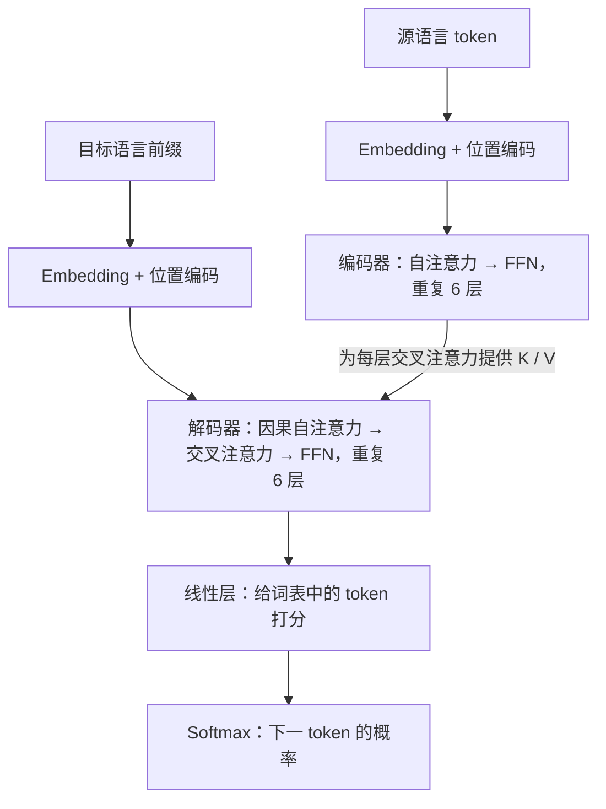

# Attention Is All You Need：从零读懂 Transformer

这篇笔记是[第 0 课：LLM 基础](../omni-LLM/第_0_课：LLM基础_从音频工程到语言模型.md)的前置阅读。目标是让你能沿着数据流解释 Transformer 怎样工作，再回去理解语言模型的训练与生成。暂时不需要阅读 MiniMind 源码，也不需要启动训练。

> [!tip] 更早一步的前置知识：RNN、LSTM、GRU
> 如果对“上一时刻的隐藏状态”“循环依赖”或 LSTM 的记忆机制还不熟悉，先读[《循环神经网络：从 RNN 到 LSTM、GRU》](../d2l/8_循环神经网络.md)，再回来理解 Transformer 为什么改变了序列的信息交互方式。

| 论文信息 | 内容                                                                                                                                                                                                                                                    |
| ---- | ----------------------------------------------------------------------------------------------------------------------------------------------------------------------------------------------------------------------------------------------------- |
| 标题   | Attention Is All You Need                                                                                                                                                                                                                             |
| 作者   | Ashish Vaswani、Noam Shazeer、Niki Parmar、Jakob Uszkoreit、Llion Jones、Aidan N. Gomez、Łukasz Kaiser、Illia Polosukhin                                                                                                                                     |
| 发表   | 2017 年，NIPS 2017（会议现称 NeurIPS）；主要工作来自 Google Brain / Google Research                                                                                                                                                                                  |
| 原文   | [本地 PDF：会议正式版，11 页](./articles/attention_is_all_you_need_1706.03762.pdf ':ignore') · [官方会议 PDF](https://papers.nips.cc/paper_files/paper/2017/file/3f5ee243547dee91fbd053c1c4a845aa-Paper.pdf) · [arXiv:1706.03762](https://arxiv.org/abs/1706.03762) |
| 本文依据 | 会议正式版的章节、图表与页码；arXiv 修订版本的页数和内容可能不同                                                                                                                                                                                                                   |

> [!tip] 分三次读，不必一次记住所有公式
> 第一次读第 1–5 节：理解“输入向量 → 计算权重 → 混合信息”，跟完一次手算。
> 第二次读第 6–9 节：把注意力装进完整网络，理解训练并行与生成串行。
> 第三次读第 10–13 节：回到论文证据，再把它接到 MiniMind 和音频工程。
> 第 3 节是数学工具箱，遇到不熟悉的符号可以随时回来查。

## 1. 论文究竟解决了什么问题

### 1.1 先看一个翻译任务

假设输入是 `I love music`，希望输出 `我 喜欢 音乐`。两边长度可以不同，词语顺序也不必一一对应。这类“一个序列变成另一个序列”的任务叫 **sequence-to-sequence，简称 Seq2Seq**。

常见分工是：

- **编码器（encoder）**读取输入，为输入各位置产生内部表示。
- **解码器（decoder）**结合输入的表示与已经输出的内容，逐步产生目标序列。

这与你熟悉的部分 ASR 模型很接近：编码器处理声学帧，解码器产生文字。但编码器、解码器是功能分工，内部不一定是 Transformer，也可以是 RNN 或 CNN。

### 1.2 之前的 RNN 为什么难以并行

RNN 处理第 $t$ 个位置时，要使用上一位置的隐藏状态：

$$
h_t=f(h_{t-1},x_t)
$$

$x_t$ 是当前位置输入，$h_t$ 是网络计算出的内部向量。即使整句话已经在内存里，计算 $h_3$ 仍要等 $h_2$，$h_2$ 又要等 $h_1$。LSTM 增加了门控和记忆机制，但仍保留这种沿序列递推的依赖。

另一个问题是信息传递的距离。若最后一个词需要利用开头的信息，RNN 中间要经过许多步状态变换。距离越长，学习这种关系通常越困难。

### 1.3 Transformer 的关键改变

Transformer 让一个位置根据内容，直接从其他允许访问的位置汇集信息。**同一层内，各位置的输出都读取上一层已经准备好的表示，不必等待同层前一位置的输出。** 这给了训练更大的并行空间。

> [!info] Attention 不是这篇论文首次提出的
> 论文之前，注意力已经用于 RNN 编码器与解码器之间的软对齐，自注意力也已有研究。本文的贡献是提出 Transformer：用注意力与逐位置前馈网络构建完整的序列转换模型，去掉序列建模中的循环和卷积，并在机器翻译上验证效果。
> 标题中的 “All You Need” 也不表示整个网络只有 Attention；它还有 embedding、前馈网络、位置编码、残差和归一化。

## 2. 进入网络的不是文字，而是一张数字表

### 2.1 Token、ID、embedding 是三个步骤

为便于讲解，先**人为规定** `I`、`love`、`music` 各是一个 token，分配 ID 为 2、5、9。实际 tokenizer 常切成子词，本文的分词和数字不是某个真实模型的结果。

```text
文字：       I       love      music
token ID：   2         5          9
查表后：    e₂        e₅         e₉      ← 每个都是一个向量
```

ID 只负责索引，不携带大小关系。embedding 是一张可训练的表，每行对应一个 token 的向量。假设为了演示，每个向量只有 4 个数，查表后的输入可以写成：

$$
X=\begin{bmatrix}
0.2 & -0.1 & 0.5 & 0.3\\
0.7 & 0.4 & -0.2 & 0.1\\
-0.3 & 0.8 & 0.2 & 0.6
\end{bmatrix}
\quad\text{形状为 }3\times4
$$

这里每一行对应一个 token，每一列是一个特征维度。原论文 base 模型每行是 512 维，不是 4 维。

### 2.2 从音频特征理解“表示”

你可以先把它类比为声学特征表的形状：音频特征常有“时间帧数 × 特征维数”，文本这里是“token 数 × 特征维数”。这样容易理解后面的矩阵运算。

不过，Mel 特征的频率轴有明确的信号处理含义，embedding 的各维通常没有预先规定的物理意义。不能把第 3 维直接命名为“情绪”、第 4 维命名为“主语”。这些数字由训练调整，用来共同表达有助于任务的信息。

同一 token 在输入查表时取到同一个向量；经过网络结合上下文后，它在不同句子里的表示就可以不同。后者通常叫 **hidden state，隐藏状态**。这是一次计算产生的数据，不是另一张永久词表。

> [!note] 本文暂时省略 batch 维度
> $X\in\mathbb{R}^{n\times d}$ 表示一条序列有 $n$ 个位置，每个位置有 $d$ 个实数特征。一次处理 $B$ 条序列时，程序里常写成 `[B, n, d]`。多一条轴并不会改变下面注意力的基本算法。

## 3. 读注意力公式前，只需四个数学工具

### 3.1 向量与加权求和

向量就是一列有顺序的数。若有两个向量 $v_1=[1,0]$、$v_2=[0,2]$，按权重 $0.75$ 和 $0.25$ 混合：

$$
0.75v_1+0.25v_2=[0.75,0.5]
$$

这是逐分量乘法、再逐分量相加。注意力最末一步做的就是这种混合；通常参与的向量更多，权重则由当前输入动态计算。

### 3.2 点积：把两个向量变成一个分数

对两个同维向量，逐项相乘再相加就是点积：

$$
q\cdot k=\sum_{r=1}^{d_k}q_rk_r
$$

例如 $[1,0]\cdot[2,1]=2$，而 $[1,0]\cdot[0,3]=0$。

注意力用这个分数表示某个查询与某个候选位置的匹配程度。模型通过训练学习怎样生成适合匹配的向量。

> [!info] 点积大，不等于天然“语义相似”
> 点积同时受向量方向和长度影响。它不是自动理解语言的规则，也不等于余弦相似度。这里的匹配含义来自训练好的表示和投影，而不是给任意两个数组做点积就能判断语义。

### 3.3 矩阵乘法：批量计算点积

矩阵是按行列排好的数字表。$K^\top$ 表示将 $K$ 的行列互换，称为转置。

如果 $Q$ 有 $n$ 行查询，$K$ 有 $m$ 行候选向量，每行都是 $d_k$ 维，那么：

$$
\underbrace{Q}_{n\times d_k}
\underbrace{K^\top}_{d_k\times m}
=\underbrace{S}_{n\times m},\qquad
S_{ij}=q_i\cdot k_j
$$

结果第 $i$ 行，就是第 $i$ 个查询与全部 $m$ 个候选位置的分数。这是矩阵乘法，不是把两个同形矩阵逐元素相乘。

### 3.4 Softmax：把一组分数变成权重

给定分数 $s_1,\ldots,s_m$，softmax 定义为：

$$
a_j=\frac{\exp(s_j)}{\sum_{r=1}^{m}\exp(s_r)}
$$

$\exp(s)$ 就是 $e^s$，其结果为正。分母把所有候选的值相加，因此输出权重非负、总和为 1，分数更高的位置获得更大权重。它通常保留多个位置的信息，不是只选最大分数那一项。

注意力里的 softmax **分别作用于分数矩阵的每一行**。每个查询独立决定怎样分配自己的权重。

## 4. Q、K、V：怎样决定从谁那里取信息

### 4.1 三种角色

假设一个位置正在更新自己的表示：

| 名称 | 直观用途 | 在计算中负责什么 |
|---|---|---|
| Query，$q$ | 当前要寻找什么 | 与各个 key 计算匹配分数 |
| Key，$k$ | 这个候选位置怎样被匹配 | 接受 query 的匹配 |
| Value，$v$ | 这个候选位置提供什么内容 | 按得到的权重参与混合 |

可以把它理解为一次“软检索”：先给所有允许访问的位置打分，再汇总它们的内容。但这里没有人工定义的关键词索引，query、key、value 都是网络计算的向量，也不会真的执行数据库检索。

### 4.2 它们怎样产生

在自注意力中，三者来自同一份输入 $X$，经过三个不同的线性投影：

$$
Q=XW_Q,\qquad K=XW_K,\qquad V=XW_V
$$

$W_Q$、$W_K$、$W_V$ 是可训练的权重矩阵。“线性投影”在这里就是把输入各维按可学习的系数组合，换成适合查询、匹配或传递内容的表示。

例如 $X$ 的形状为 $n\times512$，某一头的 $W_Q$ 为 $512\times64$，则 $Q$ 为 $n\times64$。同一个位置由此得到三种用途不同的表示。

> [!info] 分清参数与本次计算结果
> $W_Q,W_K,W_V$ 是训练后保存在模型文件里的参数；$Q,K,V$ 是本次输入计算出的中间结果，输入变化，它们也会变。这里的 $V$ 是 Value，不是词表大小；本文将词表大小另记为 $N_{\mathrm{vocab}}$。

### 4.3 一条完整公式

先不考虑遮罩，论文第 3.2.1 节、公式 (1) 是：

$$
\operatorname{Attention}(Q,K,V)
=\operatorname{softmax}\left(\frac{QK^\top}{\sqrt{d_k}}\right)V
$$

从左到右可以拆成四步：

1. $QK^\top$：计算每个查询与每个 key 的匹配分数。
2. 除以 $\sqrt{d_k}$：调整分数的尺度，$d_k$ 是每个 query/key 向量的维数。
3. 逐行 softmax：每个查询得到一组总和为 1 的权重。
4. 乘 $V$：每个查询按自己的权重，混合各位置的 value。

如果 $V$ 为 $m\times d_v$，最终输出为 $n\times d_v$。**每个查询位置得到一个新的向量；注意力不会直接在这一步输出文字。**

为什么要除以 $\sqrt{d_k}$？在各分量独立、均值为 0、方差为 1 的简化假设下，点积的方差会随 $d_k$ 增大，达到 $d_k$。缩放后可将方差控制到 1。否则分数可能过大，让 softmax 过早接近“几乎只给某项权重 1”，其梯度很小，训练更困难。这里是说明缩放动机，不是在断言训练后的所有向量都满足这些统计假设。

## 5. 手算一次注意力

只看一个查询，设 $q=[1,0]$，三个候选位置的 key 和 value 如下。**这些数字仅用于演示，不是从真实单词训练出的向量。**

| 位置 | key | value | 点积分数 |
|---|---|---|---:|
| 1 | $[2,0]$ | $[1,0]$ | 2 |
| 2 | $[1,1]$ | $[0,2]$ | 1 |
| 3 | $[0,1]$ | $[1,1]$ | 0 |

**第一步，缩放分数。** 这里 $d_k=2$，所以：

$$
s=\frac{[2,1,0]}{\sqrt{2}}\approx[1.4142,0.7071,0]
$$

**第二步，得到权重。** 三项指数值约为 $[4.1133,2.0281,1]$，总和约为 $7.1414$：

$$
a=\operatorname{softmax}(s)\approx[0.5760,0.2840,0.1400]
$$

**第三步，混合 value。**

$$
\begin{aligned}
o&=0.5760[1,0]+0.2840[0,2]+0.1400[1,1]\\
&\approx[0.7160,0.7080]
\end{aligned}
$$

新向量以位置 1 的内容为主，同时保留位置 2、3 的部分信息。如果查询变了，分数和权重就可能改变，同一批 value 也会混合出不同结果。这是注意力区别于固定加权平均的地方。

> [!question] 为什么还需要 V，不能直接混合 K 吗？
> 可以设计共享表示的简化模型，但标准注意力把“如何匹配”和“传递什么”分开学习。某个位置适合被查询匹配的特征，不一定就是需要传递给后续计算的全部信息。这也是分别学习 $W_K$ 与 $W_V$ 的意义。

如果有多个查询，对每个查询重复这套步骤即可；$QK^\top$ 和后面的矩阵乘法把这些步骤批量完成。到这里，最关键的注意力公式已经读完了。

## 6. 三种注意力，以及“多头”是什么意思

### 6.1 区别首先在于信息来自哪里、允许看哪里

| 类型 | Q 来自哪里 | K/V 来自哪里 | 可访问范围 |
|---|---|---|---|
| 编码器自注意力 | 输入序列的当前层表示 | 同一序列的当前层表示 | 有效输入位置之间可互相访问 |
| 解码器因果自注意力 | 目标序列的当前层表示 | 同一目标序列的当前层表示 | 当前位置及之前的位置 |
| 编码器—解码器注意力，又称交叉注意力 | 解码器中刚算出的表示 | 编码器最终输出 | 可访问全部有效源序列位置 |

这里“当前层表示”指注意力子层接收的输入；同一层输出之间没有递推等待。“self” 强调来源是同一个序列，不表示一个位置只能看自己。交叉注意力中，两边长度可以不同，所以分数矩阵也可以不是方阵。

以翻译为例：编码器里的 `music` 可以结合 `I love` 理解输入；解码器在准备生成 `音乐` 时，既可利用已经有的 `我 喜欢`，也可通过交叉注意力读取英文输入。

### 6.2 多头是多套投影、匹配与汇总

一组注意力权重会把信息混合成一个结果。多头注意力允许不同的投影从不同角度汇集信息，然后合并结果。

原论文 base 模型 $d_{\mathrm{model}}=512$，使用 8 个头，每头 $d_k=d_v=64$。对自注意力，可以写成：

$$
\begin{aligned}
\mathrm{head}_r&=\operatorname{Attention}(XW_Q^{(r)},XW_K^{(r)},XW_V^{(r)})\\
\operatorname{MHA}(X)&=\operatorname{Concat}(\mathrm{head}_1,\ldots,\mathrm{head}_8)W_O
\end{aligned}
$$

每头产生 $n\times64$ 的结果，沿特征维拼接成 $n\times512$，再经 $W_O$ 混合各头的信息。这里的 8 个头属于**同一层的并行分支**，不是连续堆了 8 层。

> [!note] “不同头关注不同关系”是一种直观解释
> 并没有人为指定第 1 头负责主语、第 2 头负责语气；这些投影共同接受任务损失的训练。部分头可能呈现可解释的模式，也可能重叠或冗余。仅凭某个注意力权重很大，不能认定它就是模型作出判断的完整原因。

## 7. 把注意力装进完整 Transformer

先看本文简化的数据流图，再对照原论文第 3 页 Figure 1。图中的每一层还有下面将解释的残差与归一化。



### 7.1 位置编码：让网络知道顺序

如果只拿一组 token 向量做没有位置约束的自注意力，交换输入行的顺序，输出行也只是对应交换；模块本身没有“这是第几个位置”的信息。对语言来说，`狗 咬 人` 和 `人 咬 狗` 必须区分，因此需要注入顺序信息。

原论文把位置向量加到 token embedding 上。忽略 dropout，输入可写为：

$$
x_{\mathrm{pos}}=\sqrt{d_{\mathrm{model}}}\,e_{\mathrm{token}}+\operatorname{PE}(\mathrm{pos})
$$

位置向量与 embedding 同维。其偶数、奇数维使用不同频率的正弦与余弦：

$$
\begin{aligned}
\operatorname{PE}(\mathrm{pos},2i)&=\sin\left(\frac{\mathrm{pos}}{10000^{2i/d_{\mathrm{model}}}}\right)\\
\operatorname{PE}(\mathrm{pos},2i+1)&=\cos\left(\frac{\mathrm{pos}}{10000^{2i/d_{\mathrm{model}}}}\right)
\end{aligned}
$$

$\mathrm{pos}$ 是位置编号，$i$ 是一对特征维度的编号。你可以用音频经验把它想成多组不同频率的振荡器：同一个位置在各个振荡器上取值，组合成位置特征。这里只是数学构造，不是在合成音频。

第一遍只需记住“输入既有 token 身份，也有位置”。原论文还试过可学习的位置向量，结果相近；正弦形式能计算任意位置，不意味着模型在任意长的序列上都能保持质量。

### 7.2 FFN：每个位置内部再做一次非线性变换

注意力负责跨位置传递信息；前馈网络 FFN 则独立处理每个位置的特征。论文公式 (2) 为：

$$
\operatorname{FFN}(x)=\max(0,xW_1+b_1)W_2+b_2
$$

base 模型先把 512 维变成 2048 维，经过 ReLU，再变回 512 维。ReLU 就是把负数变成 0、保留正数；它引入非线性，否则两次线性变换仍可合并成一次。

同一层中，所有位置使用同一套 FFN 参数，但各自处理自己的向量；不同层有不同参数。你可以类比在时间轴各帧上共享使用两层 $1\times1$ 卷积：这里不通过 FFN 本身混合相邻位置。

### 7.3 残差连接与 LayerNorm：让堆叠更容易训练

原论文在每个子层外采用：

$$
y=\operatorname{LayerNorm}(x+\operatorname{Sublayer}(x))
$$

残差连接把原输入 $x$ 与子层处理结果相加，让原信息和梯度有一条较直接的路径。相加要求两者形状一致，这也是多头注意力和 FFN 最终都返回 512 维的原因。

LayerNorm 对**每个位置自己的特征维**计算均值、方差，做归一化，再用可学习的缩放和平移调整。它不会把整句话平均成一个向量，也不是在 batch 之间计算统计量。作用是帮助稳定各层数值与优化过程。

原论文是先做子层、残差相加，再归一化，即常说的 **Post-LN**。现代 LLM 经常改变这个顺序，不能直接把它们的代码当成原论文逐字实现。

### 7.4 编码器和解码器各堆 6 层

原论文 base 配置中，一个编码器层有“自注意力、FFN”两个子层；一个解码器层有“因果自注意力、交叉注意力、FFN”三个子层。每个子层都有残差与归一化，编码器和解码器各重复 6 层。

论文中的 “identical layers” 表示结构相同，**不是这 6 层共享同一份权重**。随着层数增加，每个位置在上一层表示的基础上继续汇集和加工信息。

### 7.5 最后怎样输出文字

解码器最后仍输出向量。设某位置的向量为 $h_t$，线性层将其变成词表大小的分数向量：

$$
\ell_t=h_tW_{\mathrm{out}},\qquad
p_t=\operatorname{softmax}(\ell_t)
$$

这里省略可能的偏置项。$W_{\mathrm{out}}$ 把 $d_{\mathrm{model}}$ 维映射到 $N_{\mathrm{vocab}}$ 维，$\ell_t$ 中每一项叫一个 **logit**，对应词表中的一个候选 token。softmax 后才得到候选概率。

> [!info] 两个 softmax，归一化对象不同
> 注意力里的 softmax 面向“输入位置”，决定从哪些位置取信息；输出层的 softmax 面向“词表 token”，决定下一步可能输出什么。二者数学操作相同，但不能混为一个步骤。

## 8. 为什么训练能并行，生成却还要一步一步来

### 8.1 训练时答案已知，但输入要错开一个位置

继续用玩具分词，目标句是 `我 喜欢 音乐`。令 BOS 表示开始，EOS 表示结束：

| 位置 | 0 | 1 | 2 | 3 |
|---|---|---|---|---|
| 解码器输入 | BOS | 我 | 喜欢 | 音乐 |
| 希望该位置预测 | 我 | 喜欢 | 音乐 | EOS |

这就是原图 “Outputs (shifted right)” 的含义。用真实的目标前缀作为训练输入，常称为 **teacher forcing**。

但仅错位还不够：位置 0 如果能看见后面的输入 `我`，就等于提前看见了自己的答案。因此还需要因果遮罩。

### 8.2 Mask：禁止访问未来位置

对于这个四位置示例，行是 query，列是 key，可见关系为：

| 查询位置 \ 被查询位置 | BOS | 我 | 喜欢 | 音乐 |
|---|---|---|---|---|
| BOS | 允许 | 禁止 | 禁止 | 禁止 |
| 我 | 允许 | 允许 | 禁止 | 禁止 |
| 喜欢 | 允许 | 允许 | 允许 | 禁止 |
| 音乐 | 允许 | 允许 | 允许 | 允许 |

将遮罩加到 softmax 之前的分数上：

$$
\operatorname{Attention}(Q,K,V)
=\operatorname{softmax}\left(\frac{QK^\top}{\sqrt{d_k}}+M\right)V
$$

允许的位置 $M_{ij}=0$，禁止的位置 $M_{ij}=-\infty$。因为 $\exp(-\infty)=0$，被禁止的位置就获得零权重。**允许看当前位置并不泄漏答案：当前位置放的是预测目标之前的那个 token。**

> [!note] 因果 mask 与 padding mask 各管一件事
> 因果 mask 防止读取未来；padding mask 防止把批处理补齐的空位当作有效输入。原论文编码器不使用这种面向未来的因果限制，但仍需处理无效填充位置。语音中的流式分块与右看窗口也需要另外设计，不能由“用了 Transformer”自动保证。

### 8.3 并行不意味着取消了信息依赖

训练时，这几个输入 token 都已知，可以在同一层中同时计算各行，再用 mask 控制每行允许读谁。**前后层仍然顺序执行；并行的是同一层内的多个位置。**

推理时没有完整目标句。先用 BOS 得到 `我`，才能把 `我` 放入前缀继续预测 `喜欢`。这是输出内容的自回归依赖，不是 RNN 那种层内隐藏状态的递推依赖。

原论文实验使用 beam search 保留多个候选前缀，而不是只取每步最大概率；不过每条候选仍要逐步扩展。现代 KV cache 可以复用已知前缀的计算，也不消除下一 token 对前缀的依赖。

## 9. 模型究竟怎样“学会”这些矩阵

以翻译为例，给定源句 $x$，目标为 $y_1,\ldots,y_m$，一种基础训练目标是最小化正确 token 的负对数概率之和：

$$
\mathcal{L}=-\sum_{t=1}^{m}\log p_\theta(y_t\mid y_{<t},x)
$$

$\theta$ 代表全部可训练参数；$y_{<t}$ 表示目标位置之前的 token。这里的 $m$ 可包含结束标记。真实实现还会屏蔽 padding，并按有效 token 数等方式归约损失。

若正确答案得到概率 $0.8$，这一项损失约为 $0.223$；如果只有 $0.1$，损失约为 $2.303$。正确答案概率越低，惩罚越大。论文还用了 label smoothing，让监督分布不过分集中于单一答案；上式先展示更容易理解的基础版本。

一次训练更新可以按下面的因果关系理解：

1. **前向计算**：从 token 查表开始，经过注意力、FFN 和输出层，得到概率。
2. **计算损失**：检查正确目标获得多少概率。
3. **反向传播**：用链式法则，计算各参数变化会怎样影响损失，得到梯度。
4. **优化器更新**：按梯度调整 embedding、投影、FFN 等权重，再处理后续数据。

> [!info] 没有人逐个告诉注意力头应该看哪里
> 标准翻译训练直接监督的是输出 token；注意力权重通过整条计算链得到梯度，间接学会怎样分配信息。你做 TTS 微调时使用的前向、损失、反向、优化器这套流程仍然适用。新的知识主要是网络内部的数据流与监督目标。

学习架构只解释模型能怎样计算；实际能力还取决于参数量、训练数据、目标与训练过程。一个小模型采用 Transformer，也不会因此自动具备强问答或推理能力。

## 10. 论文的实验支持了哪些结论

### 10.1 原论文的配置与结果

下面数字分别来自论文第 5 节、Table 2 和 Table 3。参数量取自英德配置；不要把它们当作今天训练聊天模型的预算估算。

| 项目 | Transformer base | Transformer big |
|---|---:|---:|
| 编码器层数 / 解码器层数 | 6 / 6 | 6 / 6 |
| 表示维数 | 512 | 1024 |
| FFN 中间维数 | 2048 | 4096 |
| 注意力头数 | 8 | 16 |
| 参数量，Table 3 英德配置 | 约 6500 万 | 约 2.13 亿 |
| 训练步数 | 10 万 | 30 万 |
| 硬件与时间 | 8 张 P100，约 12 小时 | 8 张 P100，约 3.5 天 |
| 英德测试 BLEU，Table 2 | 27.3 | 28.4 |
| 英法测试 BLEU，Table 2 | 38.1 | 41.0 |

英德训练集约 450 万句对，共享 BPE 词表约 3.7 万；英法约 3600 万句对，词表约 3.2 万。它们是翻译监督数据，不是今天聊天模型常用的大规模文本预训练加指令微调流程。

优化器使用 Adam，$\beta_1=0.9$、$\beta_2=0.98$、$\epsilon=10^{-9}$；学习率先预热 4000 步，再按步数的平方根倒数下降。base 的 dropout 为 0.1，label smoothing 为 0.1。第一遍知道这些是训练设置即可，不必背参数或照搬到 MiniMind。

BLEU 主要衡量译文与参考译文的 n-gram 重合，并考虑长度惩罚。它不是“智能百分比”。论文 big 模型在英德上超过当时已有结果，包括集成模型；英法 41.0 是当时单模型的领先结果，**没有超过表中所有集成结果**。Table 3 的消融结果来自开发集，也不能直接与 Table 2 的测试结果混比。

### 10.2 为什么更容易利用 GPU，代价是什么

原论文 Table 1 比较了序列长度为 $n$、表示维数为 $d$ 时，不同模块的性质：

| 性质 | 全局自注意力的信息交互 | RNN |
|---|---|---|
| 核心计算量 | $O(n^2d)$ | $O(nd^2)$ |
| 同一层沿位置串行的步数 | $O(1)$ | $O(n)$ |
| 最远位置间传递信息的路径长度 | $O(1)$ | $O(n)$ |

$O(\cdot)$ 描述规模增长时的主要趋势，不是具体耗时。自注意力的信息交互适合矩阵并行，远处信息也能在一层直接到达；但位置两两比较，使核心计算随长度呈平方增长。

> [!warning] 不能把这张表读成“Transformer 总是更快”
> $O(n^2d)$ 是注意力交互部分；Q/K/V 投影和 FFN 还会产生约 $O(nd^2)$ 等计算。朴素实现中，每头注意力矩阵占 $O(n^2)$ 空间。层数、维数、硬件、实现、序列长度和生成方式都会影响真实速度。
> 原论文证明的是当时实验条件下的翻译效果与训练效率，不能直接推出小模型问答更聪明、流式语音时延更低，或者单张 4090 的复现实验耗时。

## 11. 从 2017 年 Transformer 到 MiniMind

现代 LLM 继承了注意力、FFN、残差和堆叠的基本思路，但常使用 **decoder-only** 结构。对 MiniMind 的纯文本语言骨干，可以先理解为：输入前缀经过一串因果 Transformer 层，直接预测后续 token；没有原论文那套独立源句编码器和编码器—解码器交叉注意力。

这不是把原论文左半边简单删掉就原样运行；目标、输入组织以及层内实现也发生了变化。

| 部分 | 原论文 base | 当前 MiniMind 文本骨干 |
|---|---|---|
| 顶层结构 | Encoder–Decoder | Decoder-only |
| 位置信息 | 加到输入上的正弦/余弦位置编码 | RoPE，在注意力中旋转 Q/K |
| 归一化 | 子层之后的 LayerNorm | 子层之前的 RMSNorm，另有 Q/K 归一化 |
| FFN | 两层线性变换 + ReLU | 门控 FFN，默认使用 SiLU，可按 SwiGLU 理解 |
| 注意力头 | 每个头各有 Q/K/V 投影 | GQA，多个 Q 头共享一组 K/V 头 |
| 学习任务 | 给定源句预测译文 | 文本骨干学习前缀条件下的 token 预测；Omni 另有模态模块与目标 |

本表的 MiniMind 侧核对自本地仓库 `model/model_minimind.py`（2026-11-10）。第一遍只需知道这些是后续演化；RoPE、RMSNorm、GQA、SwiGLU 可以回到第 0 课逐个学习，不需要在这里同时展开。

> [!info] Decoder-only 不等于整个 Omni 模型没有编码器
> 这里描述的是文本语言骨干。MiniMind-O 等多模态系统可以另外有音频或视觉编码器，将其他模态转换成语言骨干能够接收的表示。应分别看“语言骨干的结构”和“整个系统的结构”。

## 12. 与你的 ASR、TTS 和全双工目标怎样衔接

你熟悉的三个层面，可以帮助区分这里容易混淆的概念：

| 层面 | 要决定的问题 | 例子 |
|---|---|---|
| 网络结构 | 内部怎样传递、变换信息 | Transformer、CNN、RNN |
| 任务与训练目标 | 输入输出是什么，什么算预测正确 | 语音转写、翻译、文本续写、声学生成；CTC、RNN-T、flow matching 等目标 |
| 系统运行方式 | 何时收音、何时输出、如何中断 | 分段交互、流式解码、全双工、回声处理、ROS 接口 |

这些层面有关联，但不是同一个问题。Transformer 可以构成 ASR 编码器，也可以出现在声学生成网络中；flow/diffusion 描述生成或训练方式，其内部网络也可以采用 Transformer。

因此，这篇论文是理解后续模型的基础，却不直接给出端到端语音对话或全双工方案。全双工还要求处理输入输出同时推进、音频时间对齐、打断、延迟及相应训练数据。**因果文本生成也不自动等于可用的流式 ASR 或 TTS。**

学习到这里，暂时不用判断该替换哪一个音频模块。先把“表示怎样流动、什么位置可见、损失监督什么”三个问题讲清楚，再看 MiniMind-O 的模态扩展会容易很多。

## 13. 回读论文与自测

### 13.1 建议按这个顺序读原文

| 原文位置，按本地会议 PDF 页码 | 阅读任务 |
|---|---|
| 第 1 页 Abstract，第 2 页 Introduction / Background | 找出 RNN 的串行限制，区分已有注意力与本文贡献 |
| 第 3 页 Figure 1 | 从下向上读；解释左侧编码器、右侧解码器及连接两侧的箭头 |
| 第 3–5 页 §3.2、Figure 2、公式 (1) | 用本文手算例子复述注意力，再解释多头和三种使用位置 |
| 第 5–6 页 §3.3–3.5 | 对应 FFN、embedding、输出 softmax、位置编码 |
| 第 6 页 Table 1 与 §4 | 说出并行优势与长度平方开销，各自比较的是什么 |
| 第 7–9 页 §5–6、Table 2–3 | 区分训练设置、测试集结果与开发集消融，不必先背所有超参数 |

### 13.2 六道检查理解的问题

先自己解释，再展开答案。能用自己的话说明因果关系，比记住缩写更有用。

1. 注意力权重为 $[0.2,0.8]$、两个 value 为 $[1,0]$ 和 $[0,2]$，输出是多少？
2. 为什么 Q/K/V 来自同一个 X，还要用三套矩阵？
3. 自注意力输出是否已经是某个文字 token？
4. 为什么训练时可以同时计算所有目标位置，却不能让它们互相随意读取？
5. 原论文解码器中的交叉注意力，Q 和 K/V 分别来自哪里？
6. 模型用了 Transformer，是否就具备流式、全双工或强推理能力？

> [!success]- 参考答案
>
> 1. $0.2[1,0]+0.8[0,2]=[0.2,1.6]$。
> 2. 让“提出查询、接受匹配、传递内容”可以分别学习适合的表示；三者同源不意味着用途相同。
> 3. 不是，输出仍是连续向量；经过后续层和词表输出层才得到 token 分数。
> 4. 训练前缀全部已知，所以能并行计算；但未来位置可能包含当前要预测的答案，必须用因果 mask 防止泄漏。
> 5. Q 来自解码器该子层的输入，K/V 来自编码器最终输出。
> 6. 不保证。结构、任务与训练数据、系统时序分别需要设计与验证。

理解这六题后，回到[第 0 课](../omni-LLM/第_0_课：LLM基础_从音频工程到语言模型.md)，再读 token 预测、训练与 KV cache。此时可以把 Transformer 看作一套已经理解其内部数据流的计算模块，逐步补齐 LLM 的其他知识。

## 参考资料

- Vaswani et al., **Attention Is All You Need**, NIPS 2017：[官方论文与元数据](https://papers.nips.cc/paper_files/paper/2017/hash/3f5ee243547dee91fbd053c1c4a845aa-Abstract.html)、[本地 PDF](./articles/attention_is_all_you_need_1706.03762.pdf ':ignore')。
- Bahdanau et al., **Neural Machine Translation by Jointly Learning to Align and Translate**：[arXiv:1409.0473](https://arxiv.org/abs/1409.0473)。用于理解 Transformer 之前的注意力背景，属于后续选读。
- [The Illustrated Transformer](https://jalammar.github.io/illustrated-transformer/)：用图示复习各模块，属于辅助阅读；论文细节以原文为准。
