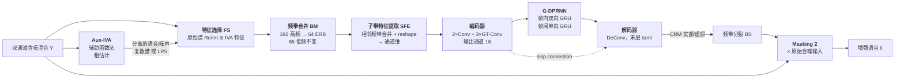

# A Lightweight Hybrid Dual Channel Speech Enhancement System under Low-SNR Conditions

> **论文**: Interspeech 2025（2025-08-17~21, Rotterdam），DOI: 10.21437/Interspeech.2025-1171
> **作者**: Zheng Wang, Xiaobin Rong, Yu Sun, Tianchi Sun, Zhibin Lin, Jing Lu
> **机构**: 南京大学近代声学实验室 · NJU-Horizon 智能音频联合实验室 · 地平线机器人 · 三星电子（中国）研发中心
> **代码**: https://github.com/Max1Wz/H-GTCRN
> **PDF**: [articles/H-GTCRN_Lightweight_Hybrid_Dual_Channel_SE_Interspeech2025.pdf](articles/H-GTCRN_Lightweight_Hybrid_Dual_Channel_SE_Interspeech2025.pdf)

---

## 核心论点（Key Thesis）

低信噪比条件下多通道语音增强的实用瓶颈是**算力**：DNN 效果好但难以端侧实时部署。本文的方案不是把模型做大，而是**让传统盲源分离和轻量神经网络各司其职**：

- **Aux-IVA（独立向量分析）** 作为**粗估计器**，提供分离后的语音/噪声作为**辅助信息**
- **改进版双通道 GTCRN** 在此基础上**精修语音质量**

这个分工的依据来自一个实测发现——IVA 与 DNN 的能力是**互补而非重叠**的：

| | 保语音（STOI） | 提质量（PESQ） |
|---|---|---|
| Aux-IVA | **强**（42 → 62.5 @ -12.5 dB） | 弱（1.05 → 1.07） |
| 单通道 GTCRN | 弱（→ 47.5） | 弱（→ 1.09） |

也就是说：**IVA 能保住语音但不提升听感质量，DNN 能提升质量但需要好的输入支撑**。把两者串起来，用 24.39k 参数就超过了 34.80k 参数的更大基线。

> 注：本文作者团队即 **GTCRN 的原作者**（Xiaobin Rong 等，ICASSP 2024），这是 GTCRN 面向低 SNR 场景的官方扩展。

---

## 问题建模

双麦克风场景，第 m 个麦克风：

```
x_m(t) = h_m(t) * s(t)                    # 语音成分（h_m 为 RIR）
y_m(t) = x_m(t) + n_m(t)                  # 含噪混合
```

STFT 域：

```
Y_m(k,l) = H_m(k,l)·S(k,l) + N_m(k,l)
```

目标是构造双通道增强系统 `f`：

```
x̂(t) = f( y₁(t), y₂(t) )
```

注意与单通道任务的区别：**空间信息（通道间相位差）是额外的可用线索**——这正是低 SNR 下单通道失效时的救命稻草。

---

## 系统架构



**各模块职责**：

| 模块 | 作用 |
|---|---|
| **FS（特征选择）** | 原始含噪谱的实部/虚部 + 选定的 IVA 特征，沿通道维拼接 |
| **BM（频带合并）** | 192 个高频带 → 64 个 ERB 带（65 个低频带保持不动），降低特征冗余 |
| **SFE（子带特征提取）** | 把相邻频带合并后 reshape 到通道维（kernel=3），**将频带关系从频率维搬到通道维**，让后续卷积更高效利用频率信息 |
| **Encoder** | 2×Conv block（Conv+BN+PReLU）+ 3×GT-Conv block；输出通道 16（单编码器）/ 12（双编码器） |
| **G-DPRNN** | 分组双路 RNN：帧内用分组**双向** GRU 捕捉谱模式，帧间用分组**单向** GRU 捕捉时间依赖 |
| **Decoder** | 镜像结构（Conv→DeConv），**末层激活改为 tanh** 约束输出到 (-1,1) |
| **Skip connection** | 缓解编码过程的信息损失 |

**GT-Conv block**（继承自原 GTCRN）：用带时间膨胀的深度可分离卷积建模长程时序依赖。输入分两支，一支过 2×P-Conv2D + DD-Conv2D，两支拼接后做 channel shuffle。DD-Conv2D 为 16 通道、kernel (3,3)，**时间膨胀率分别为 1 / 2 / 5**。

---

## Aux-IVA（粗估计器）

采用**辅助函数法**（auxiliary-function technique）的快速稳定 IVA 变体。

给定复数谱 `Y(k) = [Y₁(k), Y₂(k)]`，解混矩阵 `W = [w₁(k), w₂(k)]^H` 逐频点初始化为单位矩阵，迭代更新：

```
r_m      = sqrt( Σ_k |w_m^H(k)·Y(k)|² )                    # 逐源的广义方差
V_m(k)   = E[ G'(r_m)/r_m · Y(k)Y(k)^H ]                   # 加权协方差
w_m(k)   = ( W(k)·V_m(k) )⁻¹ · e_k                          # 更新解混向量
w_m(k)  /= sqrt( w_m^H(k)·V_m(k)·w_m(k) )                   # 归一化
```

其中 `G(·)` 为对比函数。

**计算开销极低**：仅 **0.20 MMACs/s/迭代**，参数增量可忽略。

---

## 关键设计选择（消融实验）

Table 1 — 仿真验证集（**粗体为最优**）：

| ID | 方法 | 参数 (k) | MACs (M/s) | PESQ | STOI | P.808 | SIG | BAK | OVRL |
|---|---|---|---|---|---|---|---|---|---|
| — | Noisy | — | — | 1.08 | 55.48 | 2.19 | 1.21 | 1.16 | 1.10 |
| 1 | IVA-S + Complex + Masking 1 | 24.39 | 43.20 | 1.46 | 77.83 | 3.01 | 2.37 | 3.76 | 2.11 |
| 2 | IVA-S + Complex + Masking 2 | 24.39 | 43.20 | 1.51 | 79.13 | 3.17 | 2.59 | 3.77 | 2.28 |
| 3 | IVA-S + LPS + Masking 1 | 24.15 | 41.44 | 1.49 | 78.64 | 3.11 | 2.35 | 3.76 | 2.09 |
| 4 | IVA-S&N + LPS + Masking 1 | 24.39 | 43.20 | 1.53 | 79.63 | 3.11 | 2.37 | 3.76 | 2.11 |
| 5 | IVA-S + LPS + Masking 2 | 24.15 | 41.44 | 1.57 | 79.11 | 3.25 | 2.61 | 3.81 | 2.31 |
| **6** | **IVA-S&N + LPS + Masking 2** | **24.39** | **43.20** | **1.61** | 79.57 | **3.29** | 2.60 | 3.83 | **2.32** |
| 7 | ID6 + Dual-Encoder | 25.57 | 45.63 | 1.60 | **79.99** | 3.26 | 2.56 | 3.78 | 2.28 |

> S = 仅用 IVA 分离出的语音通道；S&N = 用语音与噪声两个通道

**四条工程结论**：

1. **Masking 2 > Masking 1**（ID2>1、ID5>3、ID6>4）
   mask 应作用在**原始含噪输入**上，而不是 IVA 的输出上。论文归因于 IVA 提供的粗估计与语音保持能力——**IVA 信息用于"看"（作为特征输入），不是用于"改"（作为被掩蔽对象）**。

2. **LPS > 复数谱**（ID3 > ID1，全指标提升）
   原文结论：*"indicating that phase information is not as crucial"* —— **用 log 功率谱比用实部/虚部更好，相位信息不重要**，可以省掉实/虚分支。

3. **S&N > S**（ID6 > ID5，除 SIG 略降外几乎全指标提升）
   引入 IVA 的**噪声通道**信息收益显著。原因：两路分离信号能更全面刻画含噪混合，而只用语音通道会把注意力局限在语音成分上。

4. **Dual-Encoder 反而掉点**（ID7 < ID6，多数指标下降，仅 STOI 微升）
   参数 24.39k→25.57k、计算 43.20→45.63 MMACs 都增加，性能却下降。论文归因：**轻量网络的计算力不足以充分利用双编码器的表达空间**。
   → **工程教训：结构复杂度必须与模型容量匹配，堆结构不等于涨点。**

最终采用 **ID6** 作为对比方法。

---

## 结果对比（Table 2）

仿真测试集，三档 SNR（-12.5 / -7.5 / -2.5 dB）：

| 方法 | 参数 (k) | MACs (M/s) | PESQ<br>-12.5 / -7.5 / -2.5 | STOI<br>-12.5 / -7.5 / -2.5 | P.808 OVRL<br>-12.5 / -7.5 / -2.5 |
|---|---|---|---|---|---|
| Noisy | — | — | 1.05 / 1.05 / 1.06 | 42.00 / 50.46 / 61.07 | 1.08 / 1.09 / 1.12 |
| Aux-IVA | — | — | 1.07 / 1.13 / 1.20 | 62.52 / 70.22 / 73.37 | 1.31 / 1.53 / 1.72 |
| GTCRN | 23.43 | 32.07 | 1.09 / 1.16 / 1.31 | 47.46 / 61.12 / 72.94 | 1.49 / 1.75 / 2.09 |
| DC-GTCRN | 23.91 | 35.59 | 1.15 / 1.29 / 1.50 | 60.21 / 71.27 / 79.69 | 1.61 / 1.90 / 2.22 |
| DC-GTCRN-L | 34.80 | 49.10 | 1.17 / 1.32 / 1.54 | 61.16 / 72.13 / 80.39 | 1.66 / 1.96 / 2.28 |
| **Proposed** | **24.39** | **43.20** | **1.39 / 1.58 / 1.71** | **72.38 / 79.01 / 81.96** | **2.09 / 2.34 / 2.44** |

**四条要点**：

1. **Aux-IVA 单独使用就把 STOI 从 42.00 拉到 62.52**（-12.5 dB），但 PESQ 只从 1.05 到 1.07 —— 鲜明的"保语音不提质"特征
2. **单通道 GTCRN 在低 SNR 下接近失效**：-12.5 dB 时 PESQ 仅 1.09（无处理为 1.05），STOI 47.46（无处理 42.00）。**这是本文最有警示价值的一条数据。**
3. **参数量几乎相同，性能差距显著**：Proposed（24.39k）vs DC-GTCRN（23.91k），PESQ 提升 **+0.24**（1.39 vs 1.15 @ -12.5 dB）
4. **以小博大**：Proposed 比 DC-GTCRN-L 参数少 **30%**、计算少 **12%**，PESQ 却高 **+0.22**

论文给出的解释：加入第二通道后，DC-GTCRN 能利用通道间信息（如相位差），相对单通道 GTCRN 有全面提升；而 Proposed 进一步叠加 Aux-IVA 的辅助信息后达到最高分。

---

## 工程参数速查

| 项 | 值 |
|---|---|
| 采样率 | 16 kHz |
| STFT | sqrt-Hanning 窗，窗长 512（32 ms），hop 256（16 ms） |
| 阵列 | **线性双麦，间距 4 cm** |
| 训练 SNR | -10 ~ 0 dB |
| 测试 SNR | **-12.5 / -7.5 / -2.5 dB**（每档 500 对） |
| 房间尺寸 | 3×3×2.5 m ~ 10×10×3 m |
| RT60 | 0.1 ~ 0.4 s |
| 源到阵列距离 | 0.5 / 1 / 2 / 3 m |
| 目标与干扰的 DOA 差 | > 5° |
| 训练目标 | 第一通道前 **50 ms** 早期反射 |
| 语音数据 | DNS-3 |
| 噪声数据 | DNS-3 + DCASE |
| **参数量** | **24.39 k** |
| **计算量** | **43.20 MMACs/s** |
| 损失函数 | SISNR + ccMSE（α = 0.01, β = 0.3） |
| 优化 | Adam + linear-warmup-cosine-annealing（batch 8，200 epochs / 250k steps） |
| 学习率 | 1e-6 → 1e-3 |

---

## 与本项目的对照

> 对照基线：机器人语音交互系统现状——XVF3800 四麦阵列硬件前端 + GTCRN 降噪（Jetson Orin）+ AFE。

### 1. 这是当前 GTCRN 的直接升级路径

- **同一团队出品**（南京大学近代声学实验室，GTCRN 原作者 Xiaobin Rong 参与），代码开源（Max1Wz/H-GTCRN）
- **24.39k 参数 / 43.20 MMACs** —— 计算量对 Jetson Orin 属轻负载，端侧部署友好
- 相对单通道 GTCRN，论文在低 SNR 段的提升幅度很大

### 2. 最有警示价值的一条数据

**单通道 GTCRN 在 -12.5 dB 时几乎不工作**（PESQ 1.09 vs 无处理 1.05）。

如果部署场景会碰到低 SNR（机器人远场拾音、嘈杂环境、说话人距离 >2 m），这条数据值得警惕——**单通道降噪在低 SNR 下的天花板比预期低得多**。论文的解法是引入第二通道获取空间信息（DC-GTCRN 把 PESQ 拉到 1.15，本文方法到 1.39）。

**但要注意输入假设的差异**：

- 论文是 **双麦、间距 4 cm**；XVF3800 是**四麦阵列**，间距不同
- IVA 依赖通道间相位差（空间线索），**间距直接决定线索强度**。若阵元间距差异大，IVA 的效果需要重新验证，不能直接照搬结论

### 3. "传统 DSP 粗估计 + 神经网络精修"这个范式对本场景有直接意义

你的系统已有 XVF3800 的硬件 DSP（波束成形 + AEC）。本文的做法的关键细节是：

- IVA 的输出**作为特征输入**给网络，而**不是作为被掩蔽对象**
- mask 作用在**原始含噪信号**上（Masking 2 > Masking 1）

**推论**：复用硬件 DSP 输出时，**不要把它的输出当作待微调的最终信号，而应作为神经网络的额外输入通道**。传统算法提供的是"另一个视角"，不是"最终答案"。这个区别在消融实验里有量化体现（ID2 vs ID1：PESQ 1.51 vs 1.46）。

### 4. 三条可直接借用的工程结论

| 结论 | 依据 | 可操作性 |
|---|---|---|
| **输入特征用 LPS，不用复数谱** | ID3 > ID1（全指标提升） | 省掉实/虚分支，模型更简单；相位信息不重要 |
| **辅助信息给"语音+噪声"两路 > 只给一路** | ID6 > ID5（除 SIG 略降外全升） | 噪声信息帮助网络更全面理解混合 |
| **别盲目加结构** | ID7 < ID6（双编码器掉点） | 容量与复杂度要匹配，轻量模型上尤其明显 |

### 5. 一个低成本验证建议

想评估这个方向的收益，可以按这个顺序：

1. 先**只跑开源代码的推理**（不训练），用你的真实噪声场景对比 GTCRN 单通道基线
2. 重点看 **-10 dB 以下**的提升是否复现
3. 若有效，再考虑用自己的数据微调

**风险提示**：论文训练数据全部来自**仿真 RIR**（image method，RT60 0.1–0.4 s），与真实房间/机器人腔体的差异可能较大，泛化能力需要实测验证。另外注意论文的测试 SNR 低至 -12.5 dB，属于相当严苛的条件——如果你的实际场景 SNR 高于 0 dB，收益可能没有论文展示的那么显著。

---

## 相关论文

- **GTCRN**（本文基础架构）：X. Rong et al., "GTCRN: A Speech Enhancement Model Requiring Ultralow Computational Resources," ICASSP 2024
- **DPCRN**（GTCRN 的前身简化对象）：X. Le et al., Interspeech 2021
- **IVA / Aux-IVA**：T. Kim et al. (2006, 2007)；N. Ono, WASPAA 2011（辅助函数法）
- **CRM（复数比率掩蔽）**：D. S. Williamson et al., 2015
- **损失函数**：S. Braun & I. Tashev, TSP 2021（损失函数综述）
- **数据集**：DNS-3 Challenge（ICASSP 2021）；DCASE 2022 Task 2
